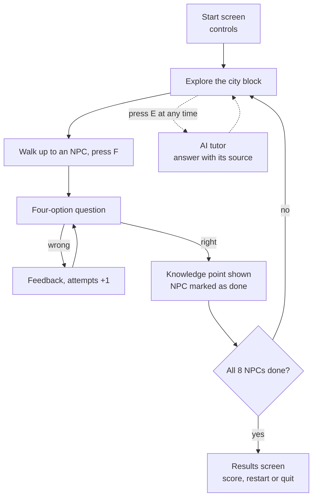
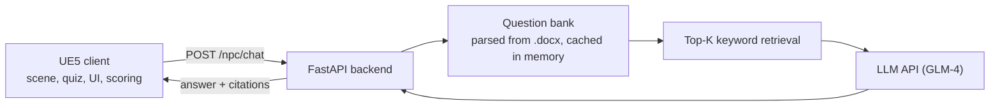

# Cyber Finance City

**English** | [中文](README.zh-CN.md)

A financial-education game built in Unreal Engine 5. The player walks through a cyberpunk city block, finds eight robot NPCs and answers a finance question from each one. At any point they can open a chat panel and ask an AI tutor, which answers from the course question bank and says which question it drew on. A separate [VR build](#vr-build) runs on a Pico headset. This was my bachelor's graduation project (Software Engineering, Sanda University, Shanghai, 2026).

**[Watch the full demo video](media/cyber-finance-city-demo.mp4)** (3 min 28 s, no sound) · [download the MP4](https://github.com/Zeeekrom/cyber-finance-city/raw/main/media/cyber-finance-city-demo.mp4)

This repository holds the showcase material: the demo video, screenshots and Blueprint captures. The Unreal project, the backend source and the thesis are not included. The game interface and the question bank are in Chinese.

## Contents

- [Why I built it](#why-i-built-it)
- [Who it is for](#who-it-is-for)
- [How it plays](#how-it-plays)
- [Design principles](#design-principles)
- [Screenshots](#screenshots)
- [Architecture](#architecture)
- [Client (Unreal Engine 5.5, Blueprint)](#client-unreal-engine-55-blueprint)
- [Blueprints and materials](#blueprints-and-materials)
- [VR build](#vr-build)
- [Backend (Python 3.11, FastAPI)](#backend-python-311-fastapi)
- [Keeping the content up to date](#keeping-the-content-up-to-date)
- [Testing](#testing)
- [Limitations and next steps](#limitations-and-next-steps)
- [Third-party work](#third-party-work)
- [Tools](#tools)

## Why I built it

Teaching tools I looked at tended to do one thing well. Some had a good-looking 3D or VR scene with little to do in it. Others had an AI chatbot that knew the subject in general but not the course. I wanted one platform where the three parts work together: a scene worth walking around, practice questions built into it, and an AI tutor that is tied to the course's own question bank so its answers can be checked.

## Who it is for

| User | What they need | What the platform gives them |
|---|---|---|
| Student | Learn finance by doing, with help when stuck | A 3D scene to explore, quiz questions that work offline, and an AI tutor for follow-up questions |
| Teacher | Control what is taught and when | Questions and feedback edited in tables, and a choice of which chapters each NPC draws from |
| Administrator | Keep it running in a classroom | Dialogue, sound and prompt settings in tables, and backend settings in one `.env` file |

## How it plays

1. The start screen lists the controls: WASD to move, Space to jump, F to talk, E for the AI tutor.
2. The player explores a compact city block. Each NPC stands in a glowing ring, yellow while its question is open and grey once it is done.
3. Pressing F at an NPC opens a four-option question. A wrong answer shows feedback and loops back to the question. A right answer shows the knowledge point behind it.
4. Pressing E opens the AI tutor. The player types a question in plain language and gets a structured answer: the concept, an example, common mistakes, a one-line summary, and the chapter and question number it came from.
5. After all eight NPCs, a results screen shows the score and offers a restart.

The score is the number of questions divided by the total number of attempts, shown as a percentage. Retrying costs points but never ends the round, so a beginner who keeps correcting mistakes still finishes with a reasonable score.

## Design principles

- **Practice, feedback, record, repeat.** Every answer gets immediate feedback, attempts are counted, and the results screen gives the player something to review.
- **Low barrier.** The game starts as soon as the scene loads. There are no settings to work through first, and one screen at the end offers restart or quit.
- **Configurable and reusable.** Dialogue layout, text speed, prompts and sounds are parameters, so the same dialogue component serves every NPC.
- **Offline first, online when available.** The quiz needs no network. Only the AI tutor does, so a classroom with a poor connection can still run the main loop.
- **Forgiving scoring.** A wrong answer adds an attempt and lets the player try again.
- **Traceable answers.** Whatever the AI tutor says comes with the chapter and question it was based on.

## Screenshots

| | |
|---|---|
|  |  |
| Start screen with the controls | The city block; the ring marks an NPC with an open question |
|  |  |
| A question with four options | Wrong answer: feedback, then "try again" |
|  |  |
| Correct answer with the knowledge point | Results screen with the score |
|  |  |
| AI tutor explaining ARCH/GARCH models | The end of the same answer, with the source chapter and question number |

## Architecture

The quiz runs entirely inside the client, so it works offline. Only the AI tutor needs the network. The client knows nothing about retrieval or the model: it sends the question text and shows the answer, so the model or the retrieval method can be changed without touching the game.

The work is split into six modules:

| Module | What it does |
|---|---|
| Scene | Renders the city block and gives each learning point a place the player can find |
| Dialogue quiz | Shows the question and options, judges the answer, and marks the NPC as finished |
| AI tutor | A separate entry point for questions in natural language |
| Scoring and results | Counts attempts and correct answers, works out the score and ends the round |
| Content and settings | Question tables, dialogue parameters and backend configuration |
| VR | A reduced build for exploring the scene and answering in a headset |

I built it in that order: the offline loop in the client first, then the backend and the AI tutor, then the citations and results that close the loop.

## Client (Unreal Engine 5.5, Blueprint)

| | |
|---|---|
|  |  |
| The city block at street level | Top view in the editor: roads, routes and landmarks |

- **Data-table quiz.** Each row of a data table is one question with its branches. A wrong option jumps to a "wrong" branch that leads back to the question, and the right option jumps to a "correct" branch that ends the dialogue. Questions, options and feedback are edited in the table, with no Blueprint changes and no recompiling.
- **One NPC class, many instances.** All NPCs are instances of the same Blueprint. At the start of a round a controller Blueprint gives each NPC a random row from its chapter's table, so every round has a different set of questions. The client ships with 115 questions, split by chapter across the tables bound to the eight NPC stations.
- **Dialogue component.** Based on a Marketplace dialogue plugin that I modified. It creates the guide ring, sets its colour and the interaction range, hides the ring during dialogue, and marks the NPC as finished afterwards. Text speed, camera behaviour and sounds are parameters in the same tables.
- **Scoring and results.** Global counters track correct answers and attempts. When the correct count reaches eight, the results screen opens and input switches to the UI. Restarting resets every counter.
- **Scene.** A compact cyberpunk city block that uses a Marketplace environment pack. An elevated rail line and neon signage act as landmarks, and the road layout gives clear routes between the eight stations, so players can find each NPC without a map.
- **Materials.** The scene's materials follow one pattern: a master material (base colour, normal, emissive, roughness offset, UV controls) with a material instance per asset. The neon look is tuned by swapping textures and adjusting emissive strength in the instances.
- **Start screen.** It lists the controls and also covers scene loading, so the first seconds in the scene do not stutter.
- **AI tutor widget.** It builds a JSON body with `player_id`, `session_id` and `message`, sends an HTTP POST, and writes the `answer` field into the panel.
- **VR build.** A separate, reduced project for Pico headsets. See [VR build](#vr-build).

## Blueprints and materials

| | |
|---|---|
|  |  |
| The controller picks a random row from an NPC's table when a round starts | Branch selection: read the current branch and jump to the next when an option is pressed |
|  |  |
| Question rows in a data table | One row: the NPC's text, the player's options and the branch each option leads to |
|  |  |
| The dialogue component spawns the guide ring and sets its colour and range | The ring is hidden while a dialogue is open |
|  |  |
| The tutor widget builds the JSON request, posts it to `/npc/chat` and handles the reply | When the correct count reaches the target, the results screen opens and input switches to the UI |
|  |  |
| Master material with the shared PBR inputs and UV controls | A material instance: textures and parameters changed without touching the graph |

## VR build

A separate, reduced project for Pico headsets (Pico Neo 3 and later), built on PICO's official Unreal Engine sample project for controller interaction. It was run and demonstrated on a headset. Its job was to check that the scene and the basic interaction hold up in VR, not to reproduce the PC version.

| | |
|---|---|
|  |  |
| The VR build in use, with the headset view shown on a monitor | In-headset view: controllers, the teleport arc and the instructions placed in the world |

- **Movement.** Parabolic-arc teleport: push the right thumbstick forward to show the arc, and release to jump to the landing point. The left thumbstick turns the view. Teleporting gets the player to an NPC quickly and causes less motion sickness than continuous movement.
- **Questions without menus.** To avoid fiddly UI clicking and widget-focus problems in VR, the four-option panel was dropped. The question and the feedback are placed as text in the world, and the player answers by walking to the left or to the right. A wrong choice can be retried, and a right one leads to the next question.
- **Guidance.** Yellow lines on the ground lead from one question to the next.

## Backend (Python 3.11, FastAPI)

- **Question bank.** The bank is a .docx file. At startup the service parses it with python-docx: it normalises the text, tracks chapter headings, and extracts each question's number, stem, options, answer and knowledge point. The result is cached in memory, so there is no database.
- **Retrieval.** The bank is small, so I used keyword scoring instead of a vector store. The player's message is split into tokens, each token found in a question's text adds 2 points, and a whole-phrase match in the stem or knowledge point adds 5. The top K questions (5 by default) go to the model.
- **Prompt.** The retrieved questions are passed as context blocks. The model is told to answer from the bank first, fall back to general finance knowledge when the bank has nothing, and keep a fixed structure.
- **Traceable answers.** The response carries `answer`, `citations` (question number, chapter, knowledge point) and `used_question_ids`. The best match is also appended to the answer text.
- **Configuration.** API key, model name, bank path, top-K, token limit and temperature all live in a `.env` file.

The one endpoint, `POST /npc/chat`:

| Field | Direction | Type | Meaning |
|---|---|---|---|
| `player_id` | request | string | Identifies the learner, kept for later statistics |
| `session_id` | request | string | Identifies one continuous tutoring session |
| `message` | request | string | The question the player typed |
| `answer` | response | string | The generated explanation, with a source note |
| `used_question_ids` | response | list | The bank questions retrieved for this answer |
| `citations` | response | list | Question number, chapter and knowledge point for each source |

The backend log during a session: 115 questions loaded at startup, then one `POST /npc/chat` per question the player asked.

## Keeping the content up to date

None of these need a Blueprint change or a rebuild:

- **New or changed questions.** Edit the rows of the data tables (stem, options, feedback, branches).
- **What each NPC asks.** Choose which chapter table each station draws from, to match the week's teaching.
- **How the dialogue feels.** Text speed, prompts, camera and sounds are table parameters.
- **Length of a round.** The number of NPCs and the count that triggers the results screen are settings.
- **How the AI tutor answers.** Top-K, token limit and model are changed in `.env`, and the bank document is replaced on the server.

## Testing

26 test cases across five modules, all passed. Most are black-box tests, with interface tests through Swagger UI and integration tests for the AI tutor.

| Module | Cases | What they cover |
|---|---|---|
| Scene | 5 | Loading, NPC interaction, reachability, no repeat interaction, random question assignment over five restarts |
| Dialogue | 5 | Question display, right and wrong answers, retry loop, double-click protection, long text |
| Scoring | 3 | Results trigger, score calculation, reset on restart |
| AI tutor | 11 | Direct, paraphrased and colloquial questions, concept comparisons, off-topic and out-of-bank questions, empty and overlong input, API failure, missing bank |
| VR | 2 | Teleport movement, stability while browsing the scene |

Two cases as they were written:

| ID | Test | Steps | Expected | Result |
|---|---|---|---|---|
| SC-004 | A finished NPC cannot be used again | Finish an NPC's question, walk back and press the interaction key | No question opens and the NPC is shown as finished | Pass |
| SC-005 | Questions are assigned at random | Restart five times and record the question IDs of each round | No repeats inside a round, eight questions each round, different sets between rounds | Pass |

Test environment:

| | |
|---|---|
| Client | Windows 10/11, Unreal Engine 5.5.1 |
| Backend | Python 3.11, FastAPI 0.124.4, Uvicorn 0.38.0, Pydantic 2.12.5 |
| Files and settings | python-dotenv 1.2.1, python-docx 1.2.0 |
| Model service | ZhipuAI SDK 2.1.5, model `glm-4` |
| Key settings | Top-K 5, 700-token output limit |
| Test tool | Swagger UI |

Response time over 50 consecutive `/npc/chat` calls (top-K 5, 700-token limit): 10 s on average, 5 s at best, 20 s at worst, no failures. Most of that time is the model generating text.

## Limitations and next steps

- Keyword retrieval ranks unreliably for paraphrased or long questions. Vector or hybrid retrieval is the next step.
- The AI tutor depends on an external model service, so its quality varies with the network, cost limits and the model's consistency. It still needs citation checks, content filtering and better fallbacks.
- Testing covered whether the system works, not whether students learn more with it. That needs a classroom study, and a dashboard of learning data would help run one.
- The VR build is a reduced demo.

## Third-party work

- **City environment.** An Unreal Marketplace cyberpunk environment pack.
- **Dialogue component.** An Unreal Marketplace dialogue plugin, modified for the quiz flow.
- **HTTP and JSON in Blueprint.** The VaRest plugin.
- **VR build.** Started from PICO's official Unreal Engine sample project for controller interaction, which provides the controllers and teleport movement.
- **Language model.** GLM-4 through the ZhipuAI API.

The learning design, the question tables and their branching, random question assignment, scoring and results, the AI tutor panel, the backend service and the tests are my own work.

## Tools

Unreal Engine 5.5.1 (Blueprint), VaRest plugin for HTTP and JSON, Python 3.11, FastAPI, Uvicorn, Pydantic, python-docx, python-dotenv, ZhipuAI SDK with GLM-4, Swagger UI, Pico Neo 3.

## Thesis and related paper

The project was submitted with a thesis written in Chinese: *Design and Implementation of a Metaverse Financial Education Platform Based on 3D Engine Technology* (April 2026). It is not published here.

A related paper that I co-authored: [Exploring User Experience and Learning Motivation as Key Mediators in Metaverse-Based Financial Big Data Education](https://doi.org/10.1145/3802133.3802247) (IECA 2026, ACM).

## Rights and contact

© 2026 Yuxiang (Evan) Huang. The video and screenshots are shared for portfolio viewing. Please ask before reusing them.

Contact: [LinkedIn](https://www.linkedin.com/in/evan-h-165976301/)
