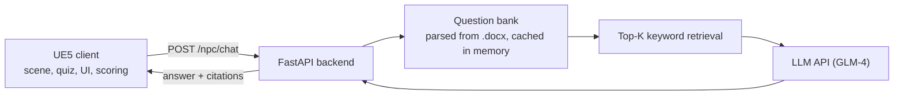

# Cyber Finance City

**English** | [中文](README.zh-CN.md)

A financial-education game built in Unreal Engine 5. The player walks through a cyberpunk city block, finds eight robot NPCs and answers a finance question from each one. At any point they can open a chat panel and ask an AI tutor, which answers from the course question bank and says which question it drew on. This was my bachelor's graduation project (Software Engineering, Sanda University, Shanghai, 2026).

**[Watch the full demo video](media/cyber-finance-city-demo.mp4)** (3 min 28 s, no sound) · [download the MP4](https://github.com/Zeeekrom/cyber-finance-city/raw/main/media/cyber-finance-city-demo.mp4)

This repository holds the showcase material: the demo video and screenshots. The Unreal project, the backend source and the thesis are not included. The game interface and the question bank are in Chinese.

## How it plays

1. The start screen lists the controls: WASD to move, Space to jump, F to talk, E for the AI tutor.
2. The player explores a compact city block. Each NPC stands in a glowing ring, yellow while its question is open and grey once it is done.
3. Pressing F at an NPC opens a four-option question. A wrong answer shows feedback and loops back to the question. A right answer shows the knowledge point behind it.
4. Pressing E opens the AI tutor. The player types a question in plain language and gets a structured answer: the concept, an example, common mistakes, a one-line summary, and the chapter and question number it came from.
5. After all eight NPCs, a results screen shows the score and offers a restart.

The score is the number of questions divided by the total number of attempts, shown as a percentage. Retrying costs points but never ends the round, so a beginner who keeps correcting mistakes still finishes with a reasonable score.

## Screenshots

| | |
|---|---|
|  |  |
| Start screen with the controls | The city block; the ring marks an NPC with an open question |
|  |  |
| A question with four options | Wrong answer: feedback, then "try again" |
|  |  |
| Correct answer with the knowledge point | Results screen with the score |
|  |  |
| AI tutor explaining ARCH/GARCH models | The end of the same answer, with the source chapter and question number |

## Architecture

The quiz runs entirely inside the client, so it works offline. Only the AI tutor needs the network. The client knows nothing about retrieval or the model: it sends the question text and shows the answer, so the model or the retrieval method can be changed without touching the game.

## Client (Unreal Engine 5.5, Blueprint)

- **Data-table quiz.** Each row of a data table is one question with its branches. A wrong option jumps to a "wrong" branch that leads back to the question, and the right option jumps to a "correct" branch that ends the dialogue. Questions, options and feedback are edited in the table, with no Blueprint changes and no recompiling.
- **One NPC class, many instances.** All NPCs are instances of the same Blueprint. At the start of a round a controller Blueprint gives each NPC a random row from its chapter's table, so every round has a different set of questions. The client ships with 115 questions, split by chapter across the tables bound to the eight NPC stations.
- **Dialogue component.** It creates the guide ring, sets its colour and the interaction range, hides the ring during dialogue, and marks the NPC as finished afterwards. Text speed, camera behaviour and sounds are parameters in the same tables.
- **Scoring and results.** Global counters track correct answers and attempts. When the correct count reaches eight, the results screen opens and input switches to the UI. Restarting resets every counter.
- **Scene.** A cyberpunk city block with an elevated rail line and neon signage as landmarks. Materials use one master material (base colour, normal, emissive, roughness offset, UV controls) with material instances per asset.
- **AI tutor widget.** It builds a JSON body with `player_id`, `session_id` and `message`, sends an HTTP POST, and writes the `answer` field into the panel.
- **VR build.** A separate, reduced build for Pico Neo 3 headsets: teleport movement, with questions shown in world space and answered by walking left or right. It does not have all the features of the PC version.

## Backend (Python 3.11, FastAPI)

- **Question bank.** The bank is a .docx file. At startup the service parses it with python-docx: it normalises the text, tracks chapter headings, and extracts each question's number, stem, options, answer and knowledge point. The result is cached in memory, so there is no database.
- **Retrieval.** The bank is small, so I used keyword scoring instead of a vector store. The player's message is split into tokens, each token found in a question's text adds 2 points, and a whole-phrase match in the stem or knowledge point adds 5. The top K questions (5 by default) go to the model.
- **Prompt.** The retrieved questions are passed as context blocks. The model is told to answer from the bank first, fall back to general finance knowledge when the bank has nothing, and keep a fixed structure.
- **Traceable answers.** The response carries `answer`, `citations` (question number, chapter, knowledge point) and `used_question_ids`. The best match is also appended to the answer text.
- **Configuration.** API key, model name, bank path, top-K, token limit and temperature all live in a `.env` file.

The backend log during a session: 115 questions loaded at startup, then one `POST /npc/chat` per question the player asked.

## Testing

26 test cases across five modules, all passed. Most are black-box tests, with interface tests through Swagger UI and integration tests for the AI tutor.

| Module | Cases | What they cover |
|---|---|---|
| Scene | 5 | Loading, NPC interaction, reachability, no repeat interaction, random question assignment over five restarts |
| Dialogue | 5 | Question display, right and wrong answers, retry loop, double-click protection, long text |
| Scoring | 3 | Results trigger, score calculation, reset on restart |
| AI tutor | 11 | Direct, paraphrased and colloquial questions, concept comparisons, off-topic and out-of-bank questions, empty and overlong input, API failure, missing bank |
| VR | 2 | Teleport movement, stability while browsing the scene |

Response time over 50 consecutive `/npc/chat` calls (top-K 5, 700-token limit): 10 s on average, 5 s at best, 20 s at worst, no failures. Most of that time is the model generating text.

## Limitations

- Keyword retrieval ranks unreliably for paraphrased or long questions. Vector or hybrid retrieval is the next step.
- The AI tutor depends on an external model service, so its quality varies with the network, cost limits and the model's consistency. It still needs citation checks, content filtering and better fallbacks.
- Testing covered whether the system works, not whether students learn more with it. That needs a classroom study.
- The VR build is a reduced demo.

## Tools

Unreal Engine 5.5.1 (Blueprint), Python 3.11, FastAPI, Uvicorn, Pydantic, python-docx, python-dotenv, ZhipuAI SDK with GLM-4, Swagger UI, Pico Neo 3.

## Thesis and related paper

The project was submitted with a thesis written in Chinese: *Design and Implementation of a Metaverse Financial Education Platform Based on 3D Engine Technology* (April 2026). It is not published here.

A related paper that I co-authored: [Exploring User Experience and Learning Motivation as Key Mediators in Metaverse-Based Financial Big Data Education](https://doi.org/10.1145/3802133.3802247) (IECA 2026, ACM).

## Rights and contact

© 2026 Yuxiang (Evan) Huang. The video and screenshots are shared for portfolio viewing. Please ask before reusing them.

Contact: [LinkedIn](https://www.linkedin.com/in/evan-h-165976301/)
