# Cyber Finance City

**English** · [简体中文](README.zh-CN.md)

Cyber Finance City is a metaverse financial-education platform built in Unreal Engine 5 and played as a game. The player walks through a cyberpunk city block, finds eight robot NPCs and answers a finance question from each one. A wrong answer gets feedback and another try, and the round ends on a results screen with a score. It is meant for finance students, and for the teachers who choose what they practise.

An AI tutor sits beside the quiz. At any point the player can press E and ask a question in their own words. A small FastAPI service finds the five best-matching questions in the course's own question bank, and GLM-4 answers from them, falling back to general finance knowledge when the bank has nothing. Each answer names the chapter and question it drew on. The quiz, the scoring and the results run in the client with no model and no network, so the tutor cannot change a score.

This was my bachelor's graduation project (Software Engineering, Sanda University, Shanghai, 2026). It is a finished prototype with a reduced VR build for a Pico headset. It has not been studied in a classroom: the tests show that the system works, not that students learn more with it.

This repository holds the showcase material only: a narrated film, a demo video, screenshots, Blueprint captures and a poster. The Unreal project, the backend source, the question bank and the thesis are not included. The game interface and the question bank are in Chinese.

<table>
<tr>
<td><a href="https://zeeekrom.github.io/cyber-finance-city/film/">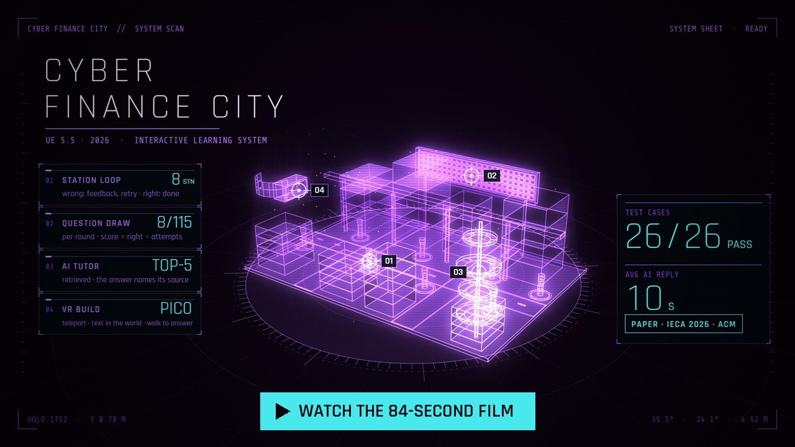</a></td>
<td><a href="media/poster.jpg">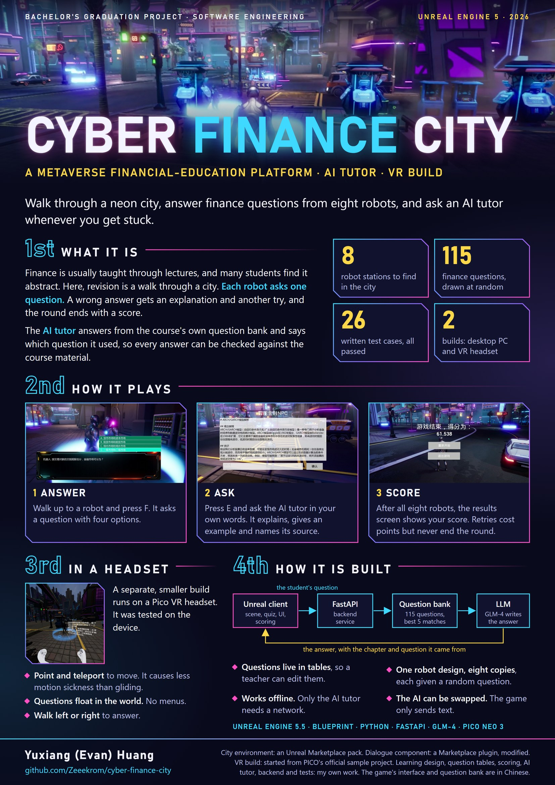</a></td>
</tr>
<tr>
<td align="center"><a href="https://zeeekrom.github.io/cyber-finance-city/film/">System Scan, 84-second film</a></td>
<td align="center"><a href="media/poster.jpg">Poster, October 2026</a></td>
</tr>
</table>

**Narrated film:** [watch *System Scan*, 84 seconds](https://zeeekrom.github.io/cyber-finance-city/film/)
— how the system works: the question loop at eight stations, the draw of 8 of the 115 questions each round, an AI tutor
that names its source, and the Pico VR build. Real gameplay with English narration (a synthetic voice); the game's
Chinese text is translated on screen.

**Demo video:** [watch the full gameplay recording](media/cyber-finance-city-demo.mp4)
— 3 min 28 s, no sound. [Download the MP4](https://github.com/Zeeekrom/cyber-finance-city/raw/main/media/cyber-finance-city-demo.mp4).

**Related paper:** [Exploring User Experience and Learning Motivation as Key Mediators in Metaverse-Based Financial Big Data Education](https://doi.org/10.1145/3802133.3802247)
— IECA 2026 (ACM). I am one of its co-authors.

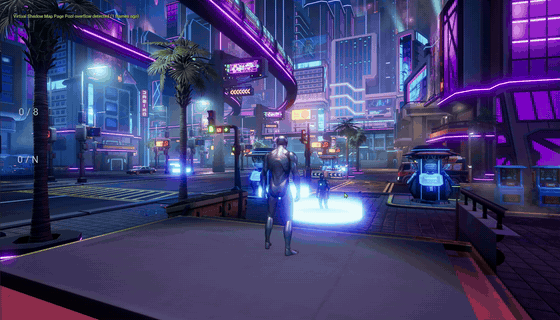

The PC build. The player walks down the street to a robot NPC standing in its glowing ring and presses F to open the robot's dialogue. Each robot asks one four-option question, and the AI tutor opens with E at any time. The on-screen text is in Chinese.

## Contents

- [At a glance](#at-a-glance)
- [The problem](#the-problem)
- [Who it is for](#who-it-is-for)
- [One round, start to finish](#one-round-start-to-finish)
- [The screens](#the-screens)
- [Where the AI tutor fits](#where-the-ai-tutor-fits)
- [What works today](#what-works-today)
- [Design principles](#design-principles)
- [How it was built](#how-it-was-built)
- [Technology stack](#technology-stack)
- [Verification evidence](#verification-evidence)
- [Content and data boundary](#content-and-data-boundary)
- [What is not finished](#what-is-not-finished)
- [What the project showed](#what-the-project-showed)
- [Copyright and terms](#copyright-and-terms)

## At a glance

| | |
|---|---|
| What it is | A walkable 3D city for practising finance: eight question stations, feedback, a score and an AI tutor |
| Who it is for | Finance students, and the teachers who decide what they practise |
| The problem | Teaching tools tended to do one thing well: a good-looking 3D or VR scene with little to do in it, or an AI chatbot that knew the subject in general but not the course |
| AI | One AI tutor. A FastAPI service retrieves the five best-matching questions from the course bank, and GLM-4 answers from them and names the chapter and question it used. The quiz and the score need no model and no network |
| Runs on | Windows PC, plus a reduced VR build on a Pico headset |
| Stack | Unreal Engine 5.5.1 (Blueprint), the VaRest plugin, Python 3.11, FastAPI, python-docx and the ZhipuAI SDK with GLM-4 |
| Scale | Eight NPC stations, 115 questions and one backend endpoint |
| Evidence | 26 written test cases across five modules, all passed; 50 consecutive tutor calls with no failures, 10 s on average |
| Content | Questions, feedback and pacing are edited in tables by a teacher, with no rebuild |
| Status | Finished graduation project, 2026. Learning gains have not been measured |

## The problem

Finance is usually taught through lectures, and many students find it abstract. The teaching tools I looked at tended to do one thing well. Some had a good-looking 3D or VR scene with little to do in it. Others had an AI chatbot that knew the subject in general but not the course.

I wanted one platform where three parts work together:

- A scene worth walking around, where each learning point has a place the player can find
- Practice questions built into the scene, with feedback, a count of attempts and a score
- An AI tutor tied to the course's own question bank, so its answers can be checked against the course

## Who it is for

| User | What they need | What the platform gives them |
|---|---|---|
| Student | Learn finance by doing, with help when stuck | A 3D scene to explore, quiz questions that work offline, and an AI tutor for follow-up questions |
| Teacher | Control what is taught and when | Questions and feedback edited in tables, and a choice of which chapters each NPC draws from |
| Administrator | Keep it running in a classroom | Dialogue, sound and prompt settings in tables, and backend settings in one `.env` file |

## One round, start to finish

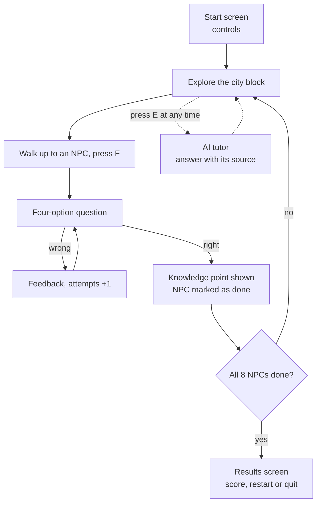

1. **The round starts.** The start screen lists the controls: WASD to move, Space to jump, F to talk, E for the AI tutor.
2. **The player explores.** Each NPC stands in a glowing ring, yellow while its question is open and grey once it is done.
3. **A question.** Pressing F at an NPC opens a four-option question. A wrong answer shows feedback and loops back to the question. A right answer shows the knowledge point behind it.
4. **The tutor.** Pressing E opens the AI tutor. The player types a question in plain language and gets a structured answer: the concept, an example, common mistakes, a one-line summary, and the chapter and question number it came from.
5. **The results.** After all eight NPCs, a results screen shows the score and offers a restart.

The score is the number of questions divided by the total number of attempts, shown as a percentage. Retrying costs points but never ends the round, so a beginner who keeps correcting mistakes still finishes with a reasonable score.

## The screens

| | |
|---|---|
| 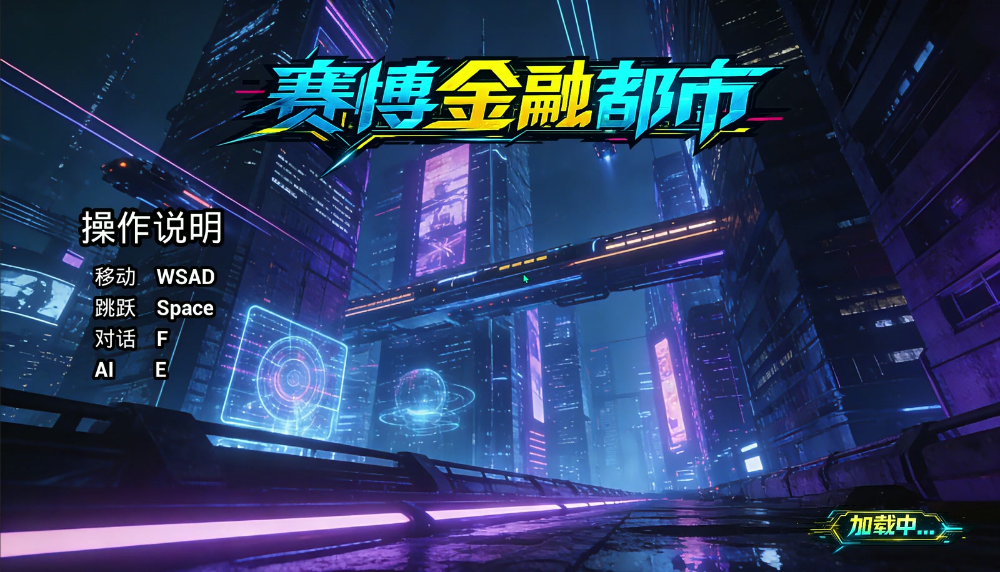 | 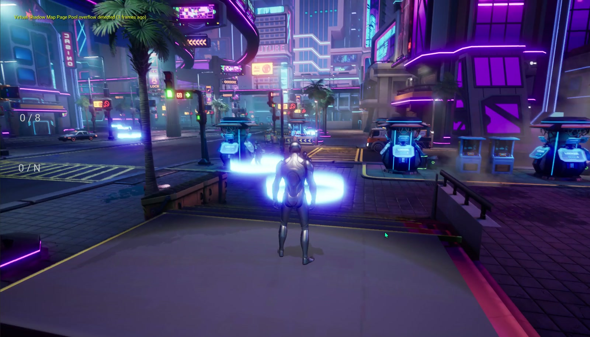 |
| **Start screen.** The controls: move, jump, talk and ask the tutor | **A station.** The ring marks an NPC with an open question |
| 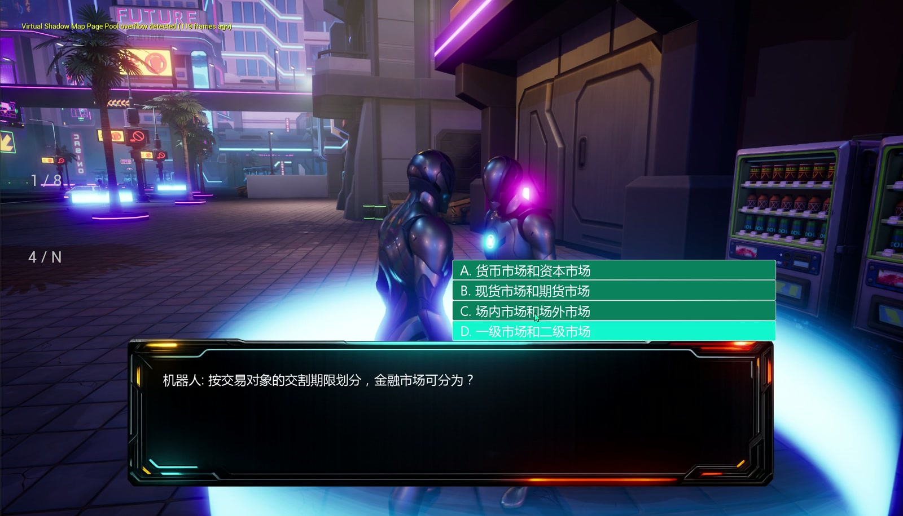 | 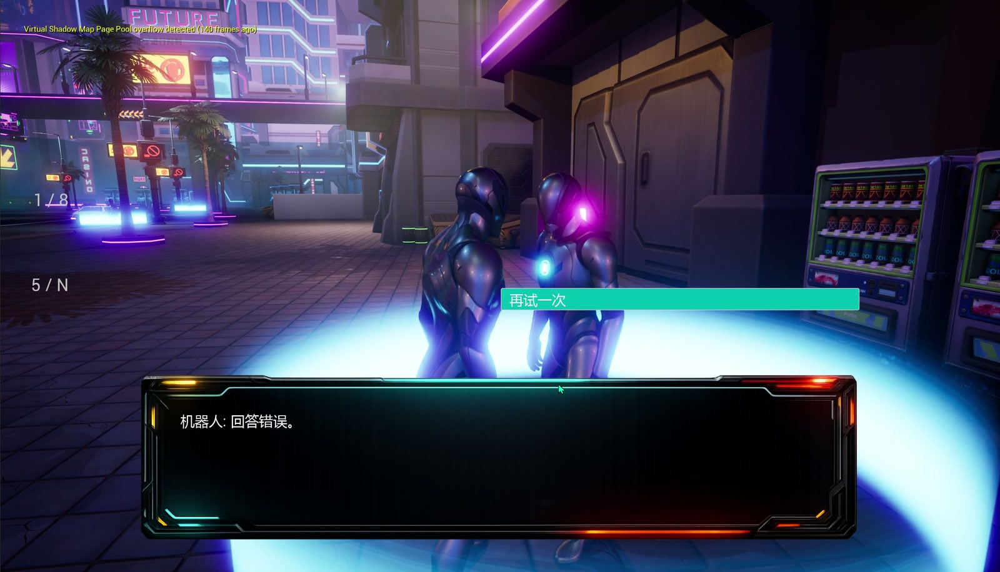 |
| **A question.** Four options | **Wrong answer.** Feedback, then "try again" |
| 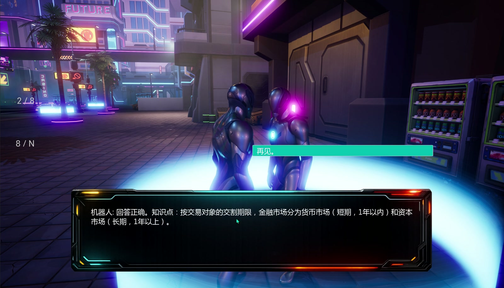 | 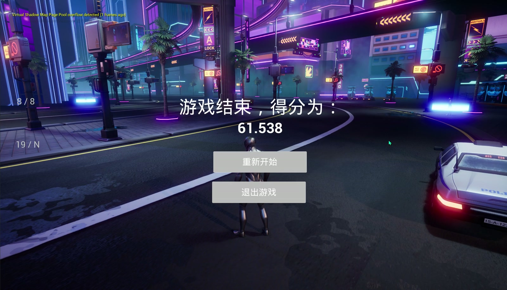 |
| **Correct answer.** The knowledge point behind it | **Results.** The score, with restart or quit |
| 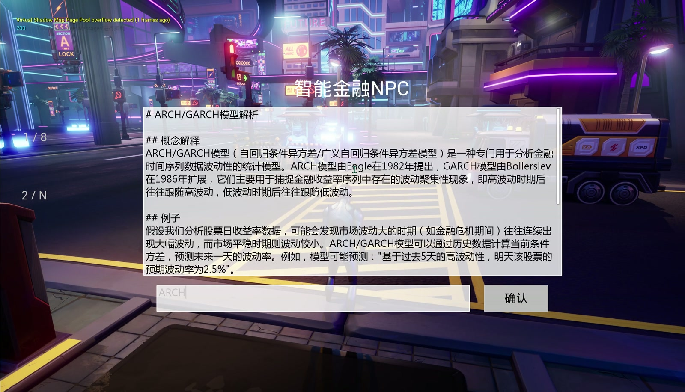 | 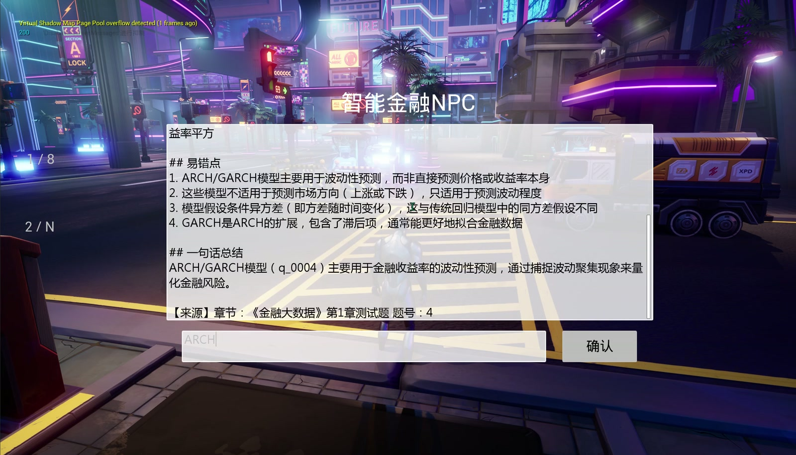 |
| **AI tutor.** Explaining ARCH/GARCH models | **The same answer's end.** The source chapter and question number |
| 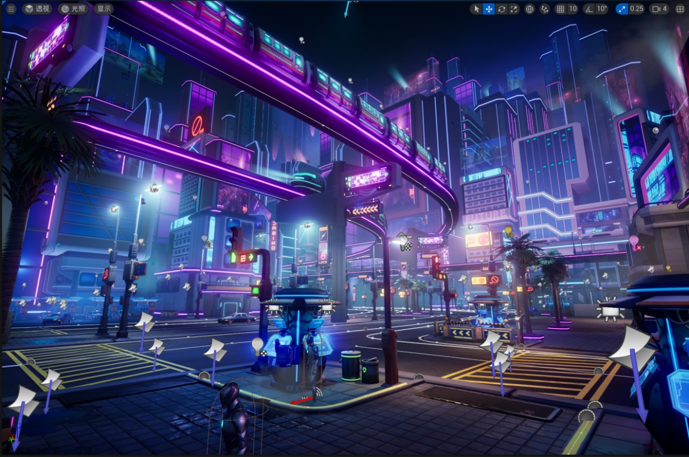 | 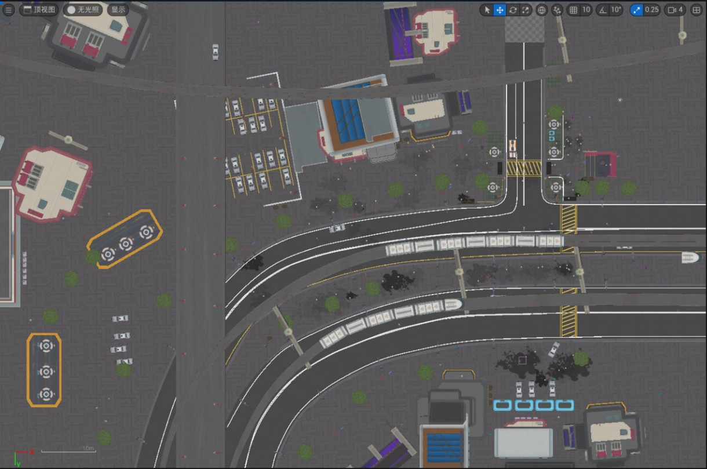 |
| **The city block** at street level | **Top view in the editor.** Roads, routes and landmarks |
| 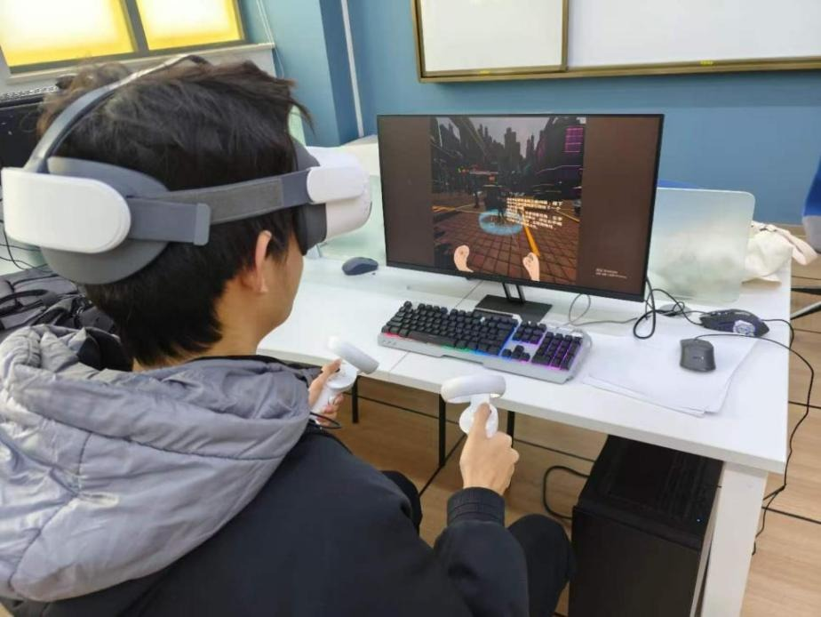 | 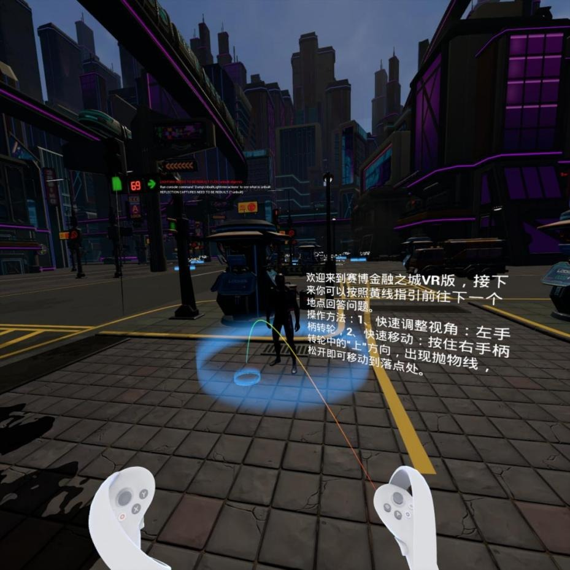 |
| **The VR build in use.** The headset view is shown on a monitor | **In the headset.** Controllers, the teleport arc and instructions placed in the world |

## Where the AI tutor fits

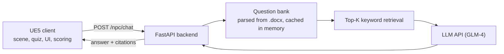

The quiz runs entirely inside the client, so it works offline. Only the AI tutor needs the network. The client knows nothing about retrieval or the model: it sends the question text and shows the answer, so the model or the retrieval method can be changed without touching the game.

- **Question bank.** The bank is a .docx file. At startup the service parses it with python-docx: it normalises the text, tracks chapter headings, and extracts each question's number, stem, options, answer and knowledge point. The result is cached in memory, so there is no database.
- **Retrieval.** The bank is small, so I used keyword scoring instead of a vector store. The player's message is split into tokens, each token found in a question's text adds 2 points, and a whole-phrase match in the stem or knowledge point adds 5. The top K questions (5 by default) go to the model.
- **Prompt.** The retrieved questions are passed as context blocks. The model is told to answer from the bank first, fall back to general finance knowledge when the bank has nothing, and keep a fixed structure.
- **Traceable answers.** The response carries `answer`, `citations` (question number, chapter, knowledge point) and `used_question_ids`. The best match is also appended to the answer text.
- **Settings.** API key, model name, bank path, top-K, token limit and temperature all live in a `.env` file.

The one endpoint, `POST /npc/chat`:

| Field | Direction | Type | Meaning |
|---|---|---|---|
| `player_id` | request | string | Identifies the learner, kept for later statistics |
| `session_id` | request | string | Identifies one continuous tutoring session |
| `message` | request | string | The question the player typed |
| `answer` | response | string | The generated explanation, with a source note |
| `used_question_ids` | response | list | The bank questions retrieved for this answer |
| `citations` | response | list | Question number, chapter and knowledge point for each source |

## What works today

| Capability | Implemented |
|---|---|
| Data-table quiz | Each row of a data table is one question with its branches. A wrong option leads to a "wrong" branch and back to the question; the right option leads to a "correct" branch that ends the dialogue |
| Random questions | All NPCs are instances of one Blueprint. At the start of a round a controller Blueprint gives each NPC a random row from its chapter's table, so each round draws 8 of the 115 questions |
| Dialogue component | Based on a Marketplace dialogue plugin that I modified. It spawns the guide ring, sets its colour and interaction range, hides it during dialogue and marks the NPC as finished |
| Scoring and results | Global counters track correct answers and attempts. At eight correct answers the results screen opens and input switches to the UI. Restarting resets every counter |
| Scene and wayfinding | A compact cyberpunk city block from a Marketplace environment pack. An elevated rail line and neon signs act as landmarks, and the road layout gives clear routes between the eight stations |
| Materials | One master material (base colour, normal, emissive, roughness offset, UV controls) with a material instance per asset. The neon look is tuned in the instances |
| AI tutor panel | Builds a JSON body with `player_id`, `session_id` and `message`, sends an HTTP POST, and writes the `answer` field into the panel |
| Content without a rebuild | Questions, options, feedback and branches; the chapter table each station draws from, to match the week's teaching; text speed, prompts, camera and sounds; the number of NPCs and the count that triggers the results screen. All are edited in tables or settings, with no Blueprint change. The tutor's top-K, token limit and model are changed in `.env`, and the bank document is replaced on the server |
| VR build | A separate, reduced project for Pico headsets (Pico Neo 3 and later), built on PICO's official Unreal Engine sample project for controller interaction. Run and demonstrated on a headset |
| VR play | Parabolic-arc teleport on the right thumbstick, which causes less motion sickness than continuous movement; the left thumbstick turns the view. To avoid fiddly clicking and widget-focus problems in VR, there is no four-option panel: the question and feedback are placed as text in the world, and the player answers by walking left or right. Yellow lines on the ground lead to the next question |

## Design principles

- **Practice, feedback, record, repeat.** Every answer gets immediate feedback, attempts are counted, and the results screen gives the player something to review.
- **Low barrier.** The game starts as soon as the scene loads. There are no settings to work through first, and one screen at the end offers restart or quit.
- **Configurable and reusable.** Dialogue layout, text speed, prompts and sounds are parameters, so the same dialogue component serves every NPC.
- **Offline first, online when available.** The quiz needs no network. Only the AI tutor does, so a classroom with a poor connection can still run the main loop.
- **Traceable answers.** Whatever the AI tutor says comes with the chapter and question it was based on.
- **The game only sends text.** The client does not know which model or retrieval method answers it.

## How it was built

The work was split into six modules: the scene, the dialogue quiz, the AI tutor, scoring and results, content and settings, and VR. I built the offline loop in the client first, then the backend and the AI tutor, then the citations and the results screen that close the loop.

| | |
|---|---|
| 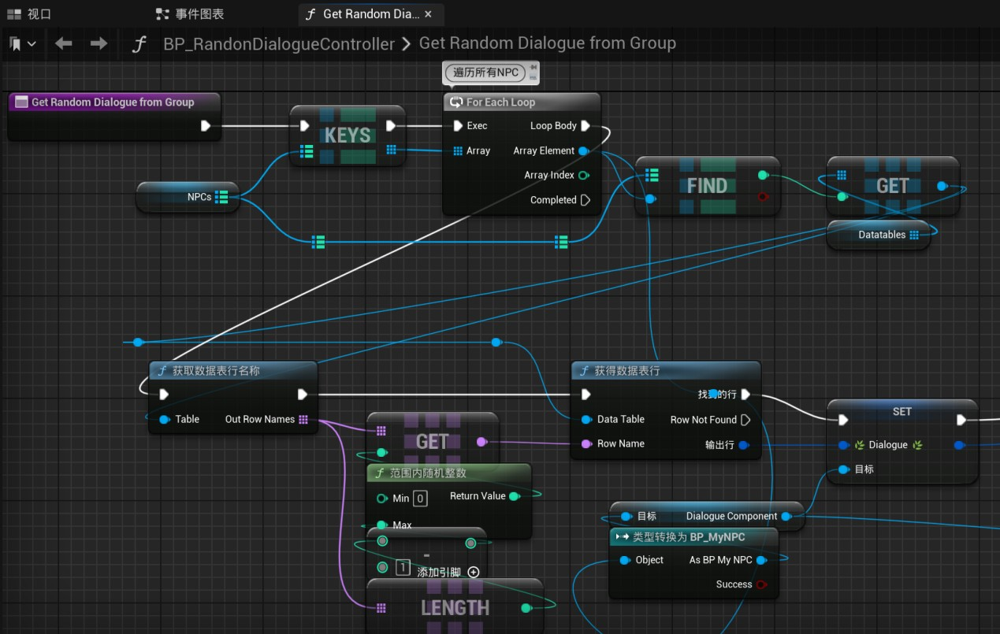 | 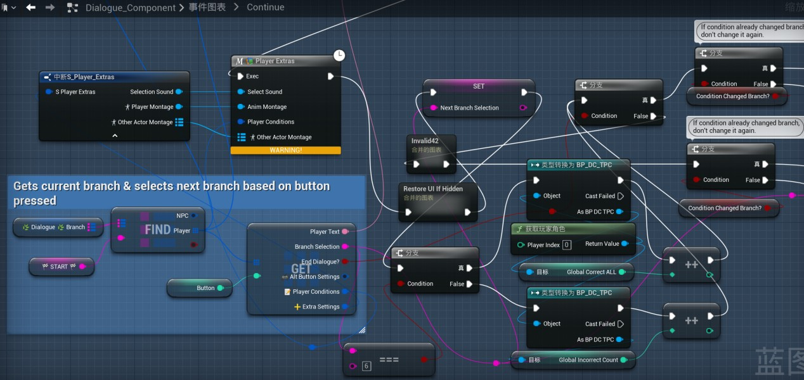 |
| The controller picks a random row from an NPC's table when a round starts | Branch selection: read the current branch and jump to the next when an option is pressed |
| 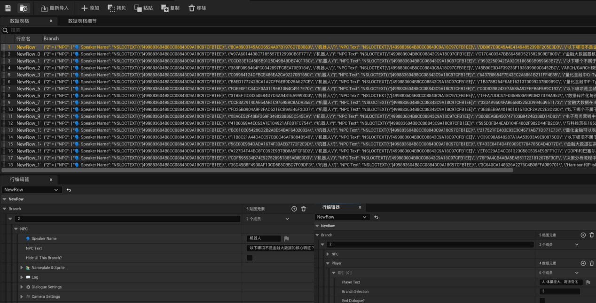 | 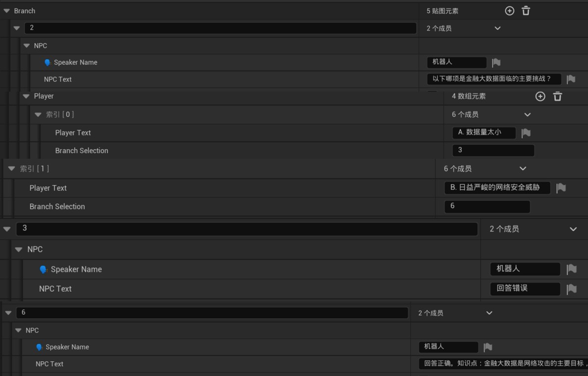 |
| Question rows in a data table | One row: the NPC's text, the player's options and the branch each option leads to |
| 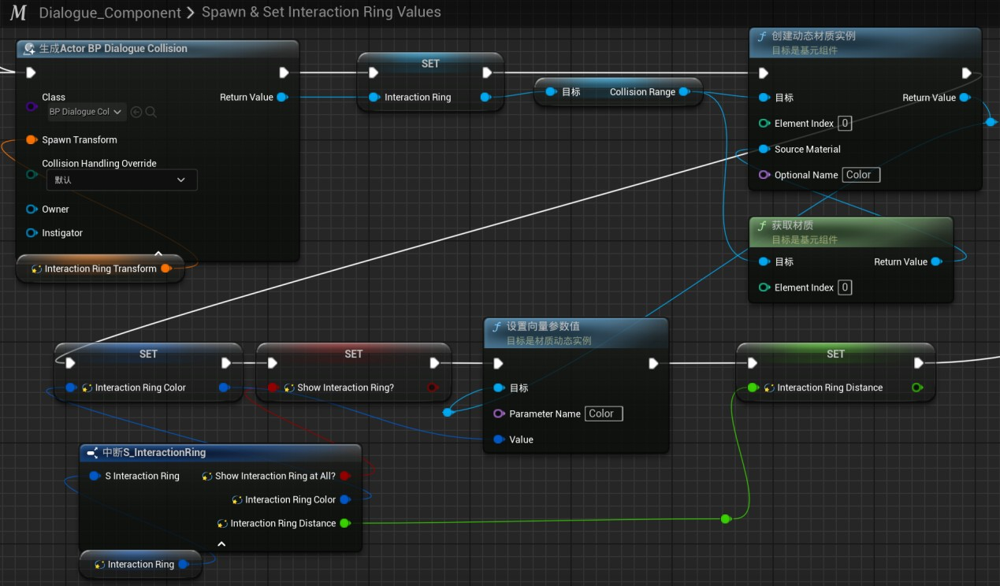 | 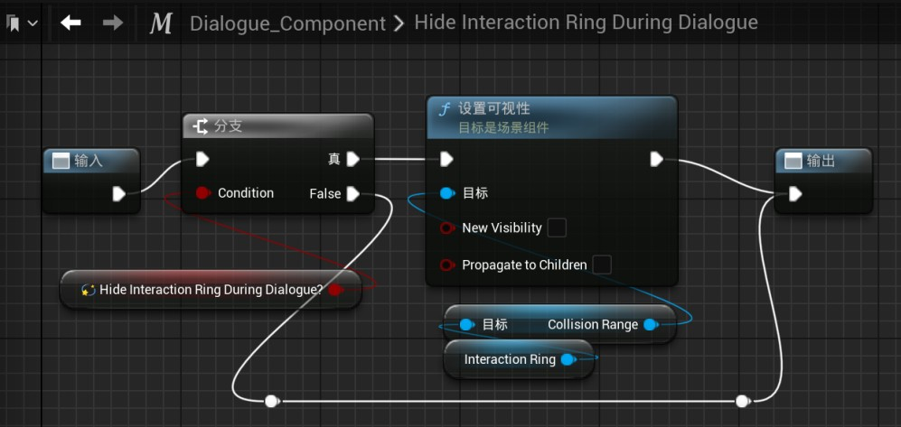 |
| The dialogue component spawns the guide ring and sets its colour and range | The ring is hidden while a dialogue is open |
| 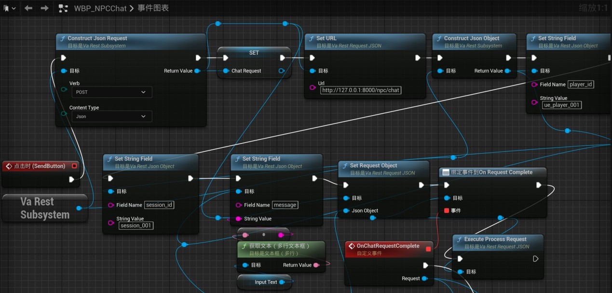 | 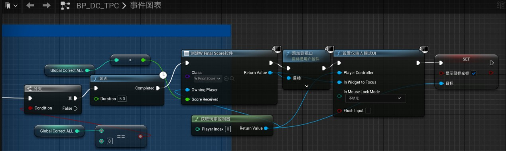 |
| The tutor widget builds the JSON request, posts it to `/npc/chat` and handles the reply | When the correct count reaches the target, the results screen opens and input switches to the UI |
| 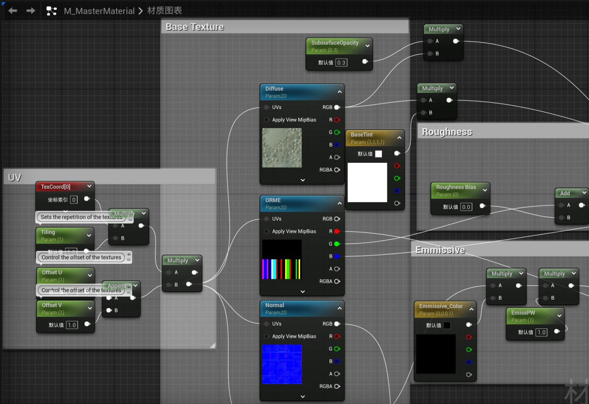 | 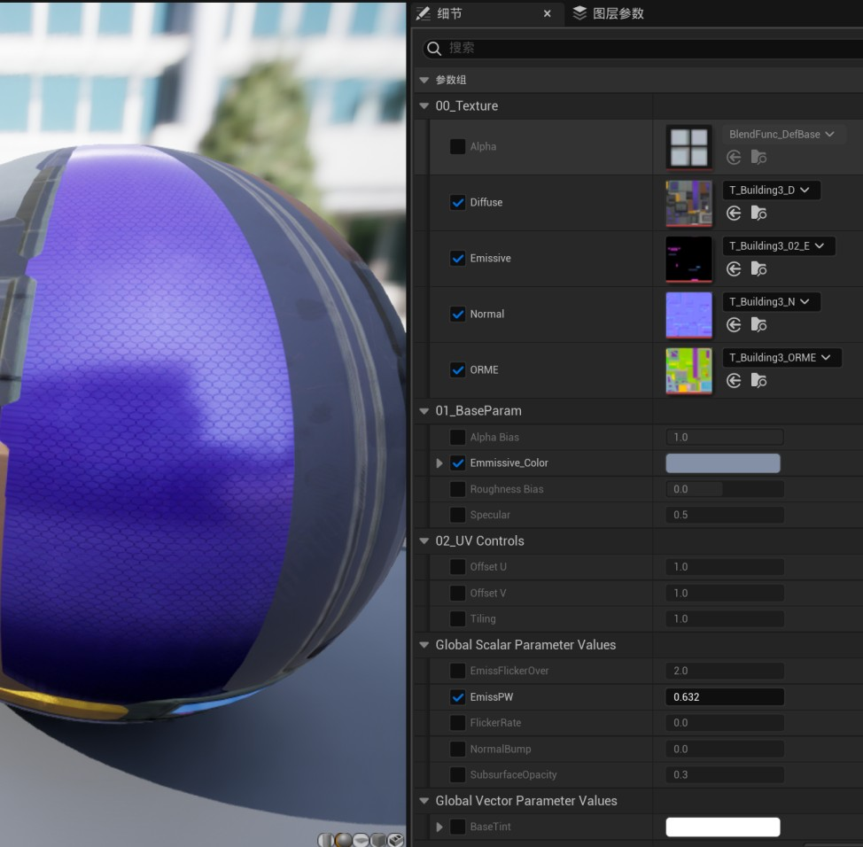 |
| Master material with the shared PBR inputs and UV controls | A material instance: textures and parameters changed without touching the graph |

| Date | What happened |
|---|---|
| April 2026 | The project was submitted with a thesis written in Chinese: *Design and Implementation of a Metaverse Financial Education Platform Based on 3D Engine Technology*. The thesis is not published here |
| 9 Oct 2026 | This showcase published: demo video, screenshots, Blueprint captures and photos of the VR build |
| 11 Oct 2026 | One-page poster, made from the screenshots in this repository |
| 14 Nov 2026 | *System Scan* film page, with a terms page |

## Technology stack

- Unreal Engine 5.5.1 with Blueprint
- VaRest plugin for HTTP and JSON in Blueprint
- Python 3.11, FastAPI 0.124.4, Uvicorn 0.38.0 and Pydantic 2.12.5
- python-docx 1.2.0 to parse the question bank, and python-dotenv 1.2.1 for settings
- ZhipuAI SDK 2.1.5 with the `glm-4` model
- Swagger UI for interface tests
- Pico Neo 3 for the VR build

Third-party parts: the city environment is an Unreal Marketplace cyberpunk environment pack; the dialogue component is an Unreal Marketplace dialogue plugin, modified for the quiz flow; HTTP and JSON in Blueprint use the VaRest plugin; the VR build started from PICO's official Unreal Engine sample project for controller interaction, which provides the controllers and teleport movement; and the language model is GLM-4 through the ZhipuAI API.

The learning design, the question tables and their branching, random question assignment, scoring and results, the AI tutor panel, the backend service and the tests are my own work.

## Verification evidence

26 test cases across five modules, all passed. Most are black-box tests, with interface tests through Swagger UI and integration tests for the AI tutor.

| Module | Cases | What they cover |
|---|---|---|
| Scene | 5 | Loading, NPC interaction, reachability, no repeat interaction, random question assignment over five restarts |
| Dialogue | 5 | Question display, right and wrong answers, retry loop, double-click protection, long text |
| Scoring | 3 | Results trigger, score calculation, reset on restart |
| AI tutor | 11 | Direct, paraphrased and colloquial questions, concept comparisons, off-topic and out-of-bank questions, empty and overlong input, API failure, missing bank |
| VR | 2 | Teleport movement, stability while browsing the scene |

Two cases as they were written:

| ID | Test | Steps | Expected | Result |
|---|---|---|---|---|
| SC-004 | A finished NPC cannot be used again | Finish an NPC's question, walk back and press the interaction key | No question opens and the NPC is shown as finished | Pass |
| SC-005 | Questions are assigned at random | Restart five times and record the question IDs of each round | No repeats inside a round, eight questions each round, different sets between rounds | Pass |

- **Response time.** 50 consecutive `/npc/chat` calls (top-K 5, 700-token limit): 10 s on average, 5 s at best, 20 s at worst, no failures. Most of that time is the model generating text.
- **Test environment.** Windows 10/11 with Unreal Engine 5.5.1; the backend versions listed under [Technology stack](#technology-stack); Swagger UI for the interface tests.
- **Question bank.** The backend log below shows 115 questions loaded at startup, then one `POST /npc/chat` per question the player asked.
- **VR.** The VR build was run and demonstrated on a headset.

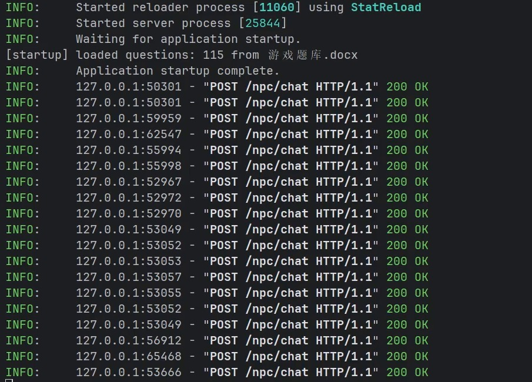

These are functional tests that I wrote and ran. They show that the system does what it was designed to do. They do not show that students learn more with it.

## Content and data boundary

- The question bank is the course's own material, kept as one .docx file on the server. It is parsed at startup and held in memory, with no database. It is not published here.
- Only the AI tutor uses the network. The client posts the player's question to the backend, and the backend sends it with the retrieved questions to GLM-4 through the ZhipuAI API.
- The API key and the other backend settings live in a `.env` file on the server. This repository holds none of the project's source code, keys or settings.
- `player_id` and `session_id` travel with each tutor request. `player_id` is kept for later statistics; a learning-data dashboard is a next step, not part of the project.
- Tutor answers come from an external model and can be wrong. The chapter and question number let a student check an answer against the course.

## What is not finished

- Keyword retrieval ranks unreliably for paraphrased or long questions. Vector or hybrid retrieval is the next step.
- The AI tutor depends on an external model service, so its quality varies with the network, cost limits and the model's consistency. It still needs citation checks, content filtering and better fallbacks.
- Testing covered whether the system works, not whether students learn more with it. That needs a classroom study, and a dashboard of learning data would help run one.
- The VR build is a reduced demo.

## What the project showed

The subject here is finance, but most of the structure is not specific to it. These are the parts I would reuse in a training or simulation product:

- **A session with a task, feedback and a result.** The learner acts in a 3D scene, each action is judged, attempts are counted, and the session ends on a score that can be reviewed.
- **Content owned by the instructor.** Which questions are asked, at which station, and how long a round lasts are set in tables and settings. Nobody opens a Blueprint to prepare a class.
- **The same scene on a monitor and in a headset.** The VR build showed what does not survive the move: menus, mouse clicks and continuous movement. Teleporting, text placed in the world and guide lines on the ground replaced them.
- **The engine as the front end of another system.** The client and the backend meet at one small interface: text in, an answer with its sources out. Either side can change without the other.
- **Finding the way without a map.** Landmarks, a clear road layout and a marker on each station that changes colour when it is done let a first-time user get around the scene.
- **Written test cases.** 26 cases with steps and expected results, grouped by module, including what happens when the model service fails or the question bank is missing.

## Copyright and terms

© 2026 Cyber Finance City. All rights reserved; see [LICENSE](LICENSE). The text, film, video, screenshots, Blueprint
captures and poster in this repository, and the project's own code and design, may not be republished, copied or
adapted without written permission. Sharing links is welcome. The third-party parts listed above keep their own
licences. Terms, licences and privacy: [terms page](https://zeeekrom.github.io/cyber-finance-city/film/terms.html).

Contact: [LinkedIn](https://www.linkedin.com/in/evan-h-165976301/)
