# Cyber Finance City

[English](README.md) · **简体中文**

Cyber Finance City（赛博金融都市）是一个用 Unreal Engine 5 制作的元宇宙金融教育平台，以游戏的方式进行。玩家在一个赛博朋克风格的城市街区里行走，找到八个机器人 NPC，分别回答一道金融题。答错会得到提示，可以再试；一局结束时进入结算界面，显示得分。它面向学金融的学生，也面向决定学生练什么的教师。

AI 导师放在答题旁边。玩家随时可以按 E，用自己的话提问。一个小型 FastAPI 服务从课程自己的题库里找出最匹配的五道题，GLM-4 依据这些题作答，题库里没有相关内容时再补充通用金融知识。每个回答都注明它参考的章节和题号。答题、计分和结算都在客户端里运行，不需要模型，也不需要网络，所以 AI 导师改变不了分数。

这是我的本科毕业设计（软件工程专业，上海杉达学院，2026 年）。它是一个已完成的原型，另有一个在 Pico 头显上运行的简化 VR 版本。它没有在课堂上做过研究：测试说明系统能正常工作，但不能说明学生用它学得更好。

本仓库只放展示材料：一部讲解短片、一段演示视频、截图、蓝图截图和一张海报。Unreal 工程文件、后端源码、题库和毕业论文都不在其中。游戏界面和题库都是中文的。

<table>
<tr>
<td><a href="https://zeeekrom.github.io/cyber-finance-city/film/">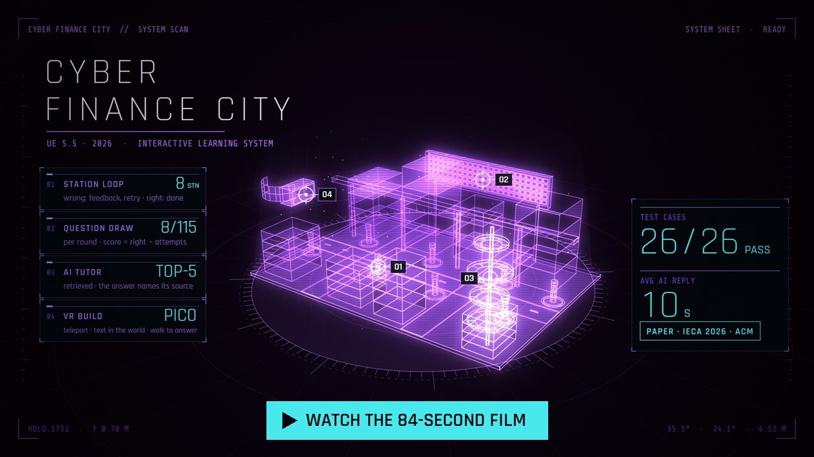</a></td>
<td><a href="media/poster.jpg">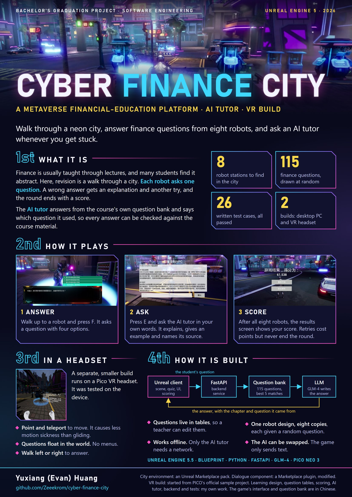</a></td>
</tr>
<tr>
<td align="center"><a href="https://zeeekrom.github.io/cyber-finance-city/film/">System Scan，84 秒短片</a></td>
<td align="center"><a href="media/poster.jpg">海报，2026 年 10 月</a></td>
</tr>
</table>

**讲解短片：** [观看 *System Scan*，84 秒](https://zeeekrom.github.io/cyber-finance-city/film/)
——系统是怎么工作的：八个答题点的答题流程、每局从 115 道题里抽 8 道、注明来源的 AI 导师，以及 Pico VR 版本。真实游戏画面，
英文旁白（合成语音）；游戏里的中文已在画面上译成英文。

**演示视频：** [观看完整的游戏录屏](media/cyber-finance-city-demo.mp4)
——3 分 28 秒，无声。[下载 MP4](https://github.com/Zeeekrom/cyber-finance-city/raw/main/media/cyber-finance-city-demo.mp4)。

**相关论文：** [Exploring User Experience and Learning Motivation as Key Mediators in Metaverse-Based Financial Big Data Education](https://doi.org/10.1145/3802133.3802247)
——IECA 2026（ACM），我是合著者之一。

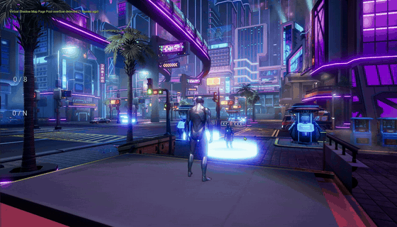

PC 版本。玩家沿街走到站在发光引导环里的机器人 NPC 前，按 F 打开它的对话。每个机器人出一道四选一的题，随时可以按 E 呼出 AI 导师。画面上的文字是中文。

## 目录

- [一眼看懂](#一眼看懂)
- [要解决的问题](#要解决的问题)
- [给谁用](#给谁用)
- [一局从头到尾](#一局从头到尾)
- [界面](#界面)
- [AI 导师在什么位置](#ai-导师在什么位置)
- [已经做到的](#已经做到的)
- [设计原则](#设计原则)
- [怎么一步步做出来的](#怎么一步步做出来的)
- [技术栈](#技术栈)
- [验证证据](#验证证据)
- [内容与数据边界](#内容与数据边界)
- [还没做完的](#还没做完的)
- [这个项目说明了什么](#这个项目说明了什么)
- [版权与条款](#版权与条款)

## 一眼看懂

| | |
|---|---|
| 是什么 | 一座可以走动的 3D 城市，用来练习金融知识：八个答题点、反馈、得分，外加一个 AI 导师 |
| 给谁用 | 学金融的学生，以及决定学生练什么的教师 |
| 要解决的问题 | 教学工具往往只做好了一件事：有的 3D 或 VR 场景很好看，但进去之后没什么可做的；有的接了 AI 对话，懂通用知识，却不了解这门课本身 |
| AI | 一个 AI 导师。FastAPI 服务从课程题库里检索最匹配的五道题，GLM-4 依据这些题作答，并注明用到的章节和题号。答题和计分不需要模型，也不需要网络 |
| 运行平台 | Windows PC，另有一个在 Pico 头显上运行的简化 VR 版本 |
| 技术栈 | Unreal Engine 5.5.1（蓝图）、VaRest 插件、Python 3.11、FastAPI、python-docx，以及 ZhipuAI SDK 与 GLM-4 |
| 规模 | 八个 NPC 答题点，115 道题，一个后端接口 |
| 证据 | 五个模块共 26 条成文的测试用例，全部通过；连续 50 次调用 AI 导师接口没有失败，平均 10 秒 |
| 内容维护 | 题目、反馈和节奏由教师在数据表里修改，不需要重新打包 |
| 状态 | 已完成的毕业设计，2026 年。没有测量过学习效果 |

## 要解决的问题

金融课通常靠讲授，很多学生觉得它抽象。我调研过的教学工具往往只做好了一件事：有的 3D 或 VR 场景很好看，但进去之后没什么可做的；有的接了 AI 对话，懂通用知识，却不了解这门课本身。

我想做一个把三件事放在一起的平台：

- 一个值得逛的场景，每个学习点位都有一个玩家找得到的位置
- 嵌在场景里的练习题，有反馈、有尝试次数、有得分
- 一个绑定课程题库的 AI 导师，它的回答可以拿课程内容来核对

## 给谁用

| 用户 | 需要什么 | 平台提供什么 |
|---|---|---|
| 学生 | 在动手中学金融，卡住时有人讲解 | 可以探索的 3D 场景、离线可用的答题，以及可以追问的 AI 导师 |
| 教师 | 控制教什么、什么时候教 | 题目和反馈在表格里编辑，并可以指定每个 NPC 从哪些章节出题 |
| 管理员 | 让系统在课堂上稳定运行 | 对话、音效和提示的参数都在表格里，后端配置集中在一个 `.env` 文件 |

## 一局从头到尾

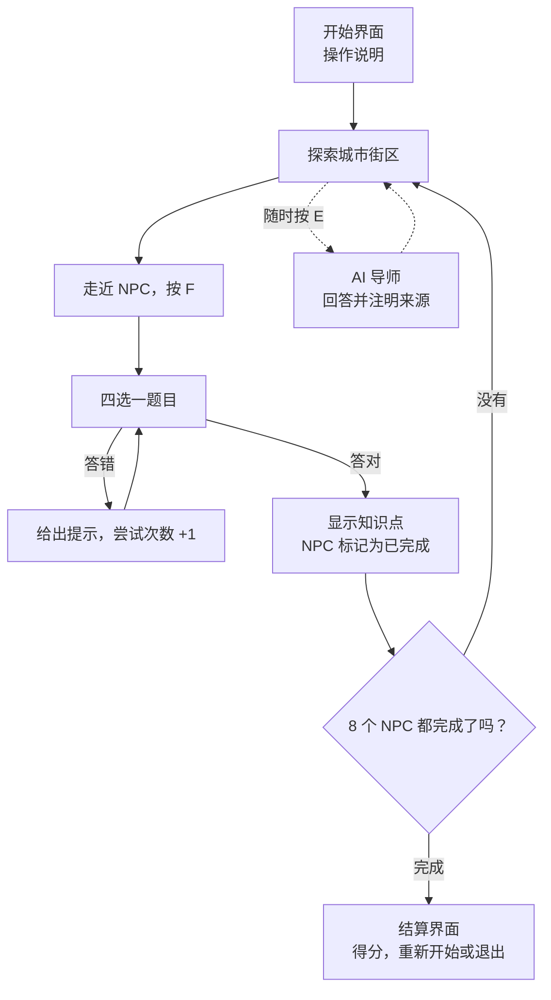

1. **开局。** 开始界面列出操作方式：WASD 移动，空格跳跃，F 对话，E 呼出 AI 导师。
2. **探索。** 每个 NPC 脚下有一圈发光的引导环，题目未完成时是黄色，完成后变成灰色。
3. **答题。** 在 NPC 旁按 F 会弹出一道四选一的题目。答错会给出提示并回到题目重新作答，答对则显示这道题对应的知识点。
4. **问导师。** 按 E 打开 AI 导师，用自然语言输入问题，得到一段结构化的回答：概念解释、例子、易错点、一句话总结，以及来源的章节和题号。
5. **结算。** 八个 NPC 全部完成后进入结算界面，显示得分，并可以重新开始。

得分等于题目数量除以总尝试次数，以百分比显示。答错重试会拉低分数，但不会结束本局，所以初学者只要坚持纠错，最后仍能拿到一个合理的分数。

## 界面

| | |
|---|---|
| 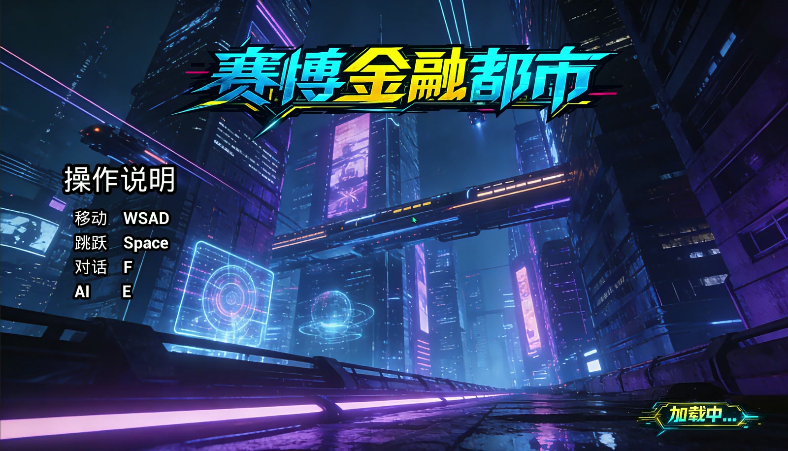 | 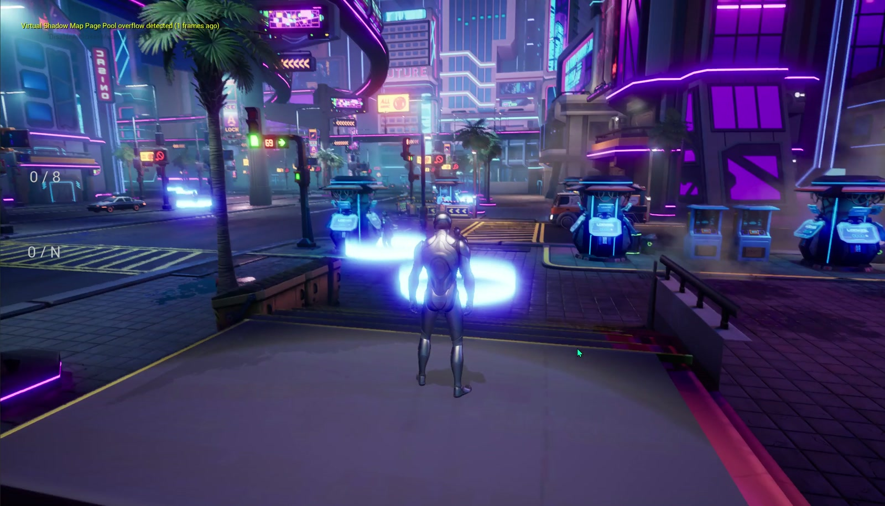 |
| **开始界面。** 操作说明，场景在背后加载 | **答题点。** 引导环标出尚未完成的 NPC |
| 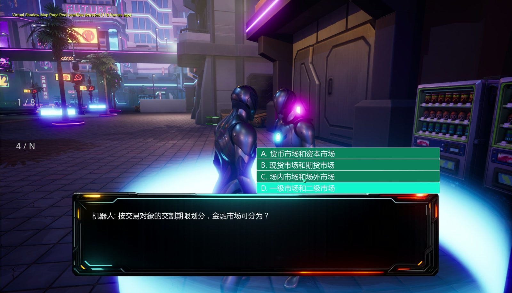 | 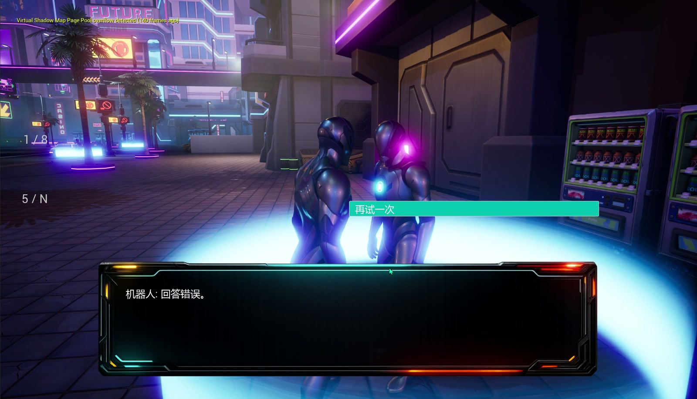 |
| **题目。** 四个选项 | **答错。** 先给提示，再"再试一次" |
| 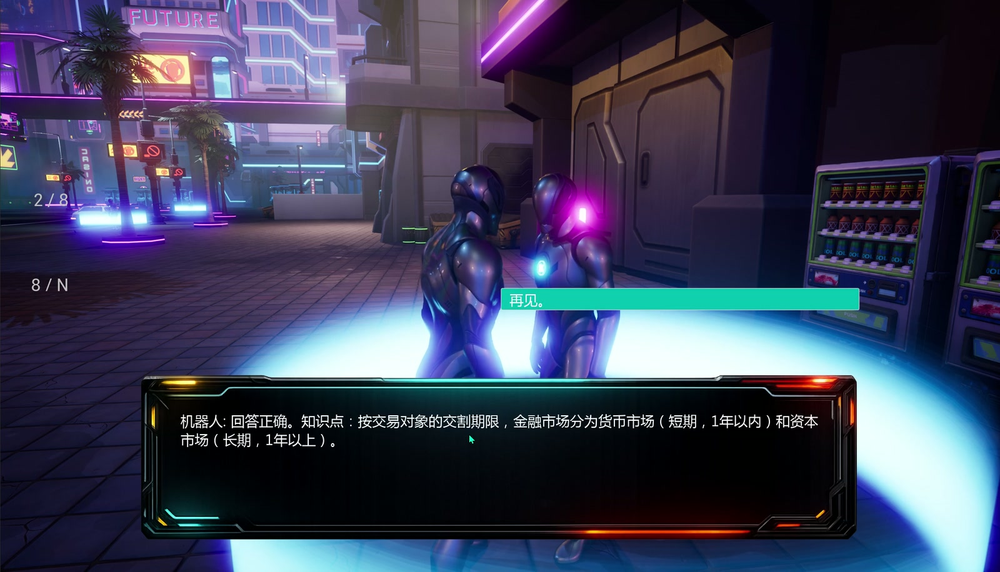 | 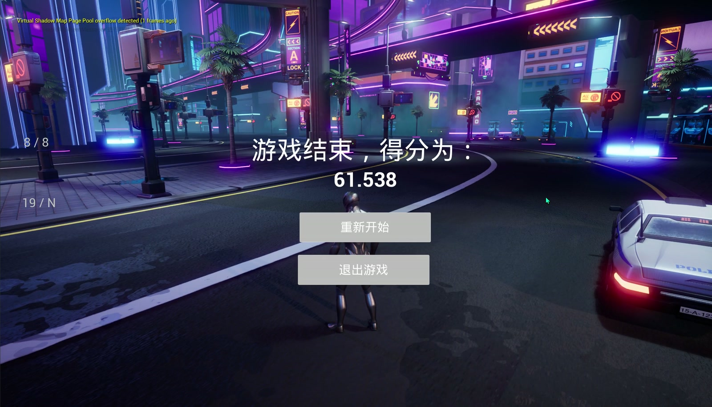 |
| **答对。** 显示这道题背后的知识点 | **结算。** 得分，可以重新开始或退出 |
| 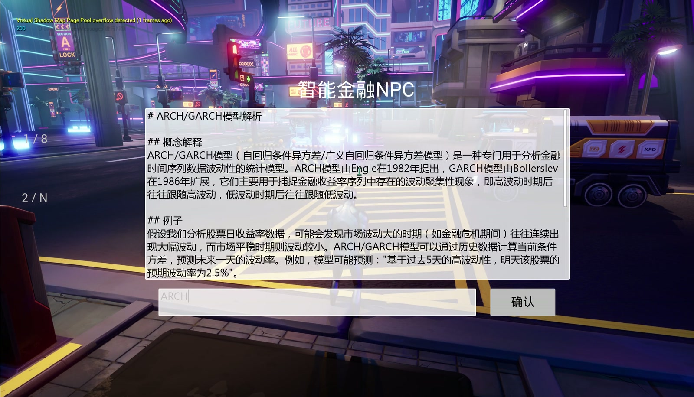 | 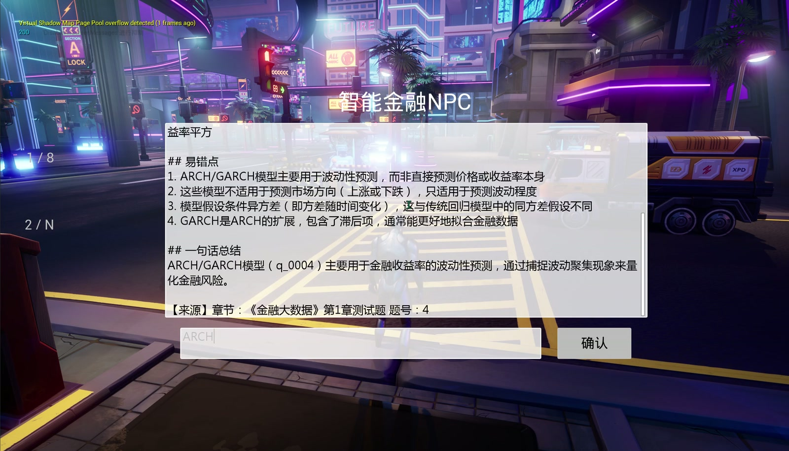 |
| **AI 导师。** 讲解 ARCH/GARCH 模型 | **同一段回答的末尾。** 附有来源章节和题号 |
| 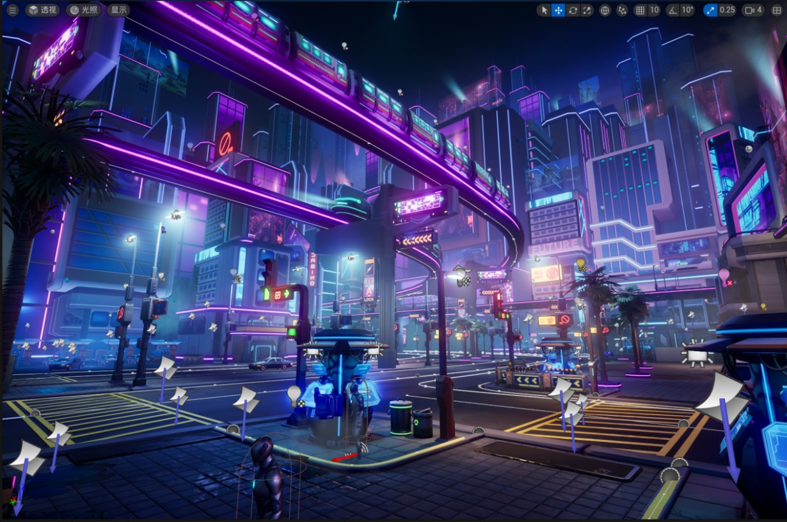 | 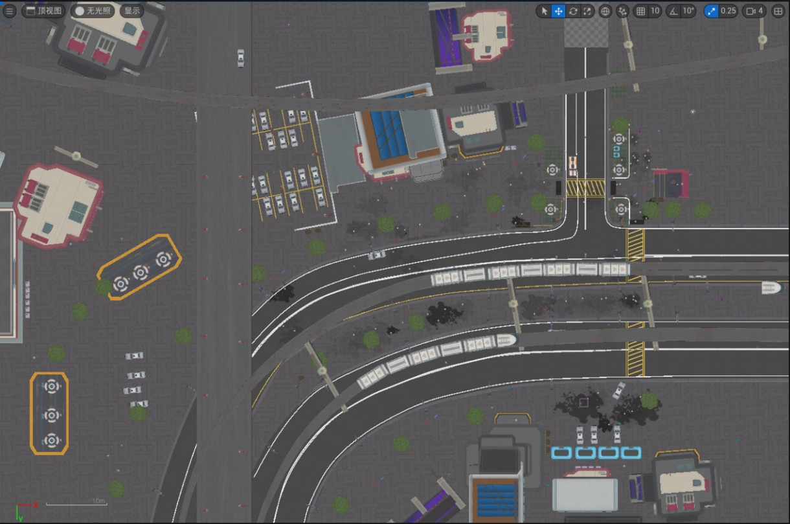 |
| **城市街区**，街道视角 | **编辑器里的顶视图。** 道路、动线和地标 |
| 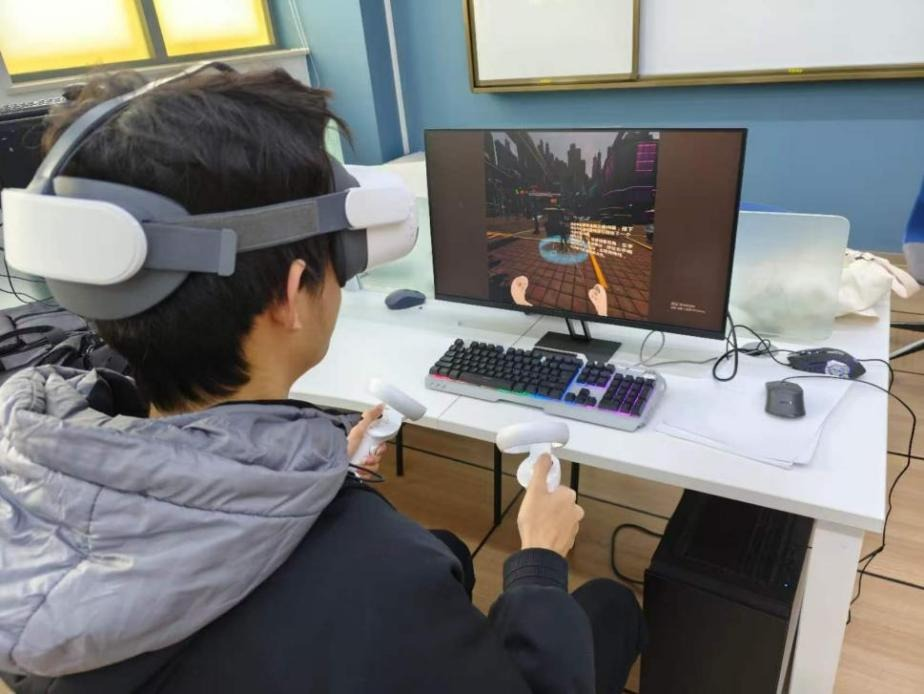 | 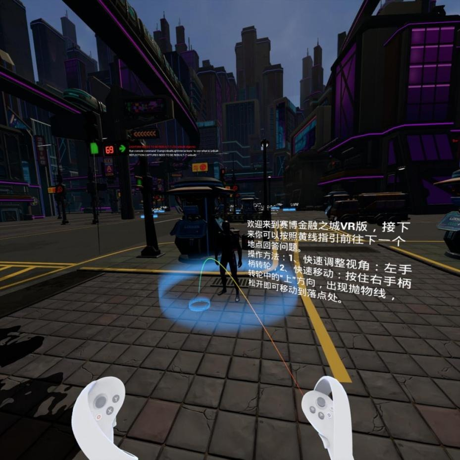 |
| **VR 版本的使用场景。** 头显画面同步显示在显示器上 | **头显内画面。** 手柄、瞬移抛物线，以及放在场景里的操作说明 |

## AI 导师在什么位置

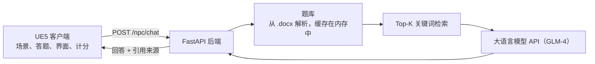

答题部分完全在客户端内运行，离线也能用，只有 AI 导师需要联网。客户端不关心检索和模型：它只负责把问题发出去、把回答显示出来，所以更换模型或调整检索方式都不需要改动游戏本身。

- **题库。** 题库是一个 .docx 文件。服务启动时用 python-docx 解析：规范化文本，识别章节标题，提取每道题的题号、题干、选项、答案和知识点。解析结果缓存在内存里，不使用数据库。
- **检索。** 题库规模不大，所以我用关键词计分代替了向量库。玩家的提问被切分成若干词，每命中一个词加 2 分，整句片段命中题干或知识点加 5 分，取得分最高的前 K 道题（默认 5 道）交给模型。
- **提示词。** 检索到的题目以上下文块的形式传入。提示词要求模型优先依据题库作答，题库没有时再补充通用金融知识，并保持固定的回答结构。
- **可追溯的回答。** 响应中包含 `answer`、`citations`（题号、章节、知识点）和 `used_question_ids`，最相关的一条来源还会追加在回答末尾。
- **配置。** API 密钥、模型名、题库路径、Top-K、输出长度上限和 temperature 都放在 `.env` 文件里。

唯一的接口 `POST /npc/chat`：

| 字段 | 方向 | 类型 | 含义 |
|---|---|---|---|
| `player_id` | 请求 | string | 学习者标识，为后续统计预留 |
| `session_id` | 请求 | string | 标识一次连续的答疑会话 |
| `message` | 请求 | string | 玩家输入的问题 |
| `answer` | 响应 | string | 生成的讲解，附来源提示 |
| `used_question_ids` | 响应 | list | 本次检索命中的题目 |
| `citations` | 响应 | list | 每条来源的题号、章节和知识点 |

## 已经做到的

| 能力 | 已实现的内容 |
|---|---|
| 数据表驱动的答题 | 数据表的每一行是一道题及其分支。错误选项跳到"回答错误"分支，再回到题目；正确选项跳到"回答正确"分支并结束对话 |
| 随机出题 | 所有 NPC 都是同一个蓝图类的实例。每局开始时，一个控制器蓝图从各 NPC 对应章节的数据表里随机抽一行分配给它，所以每局从 115 道题里抽出 8 道 |
| 对话组件 | 基于一个商城对话插件，我做了修改。它生成引导环、设置颜色和交互距离、在对话期间隐藏引导环，并在结束后把 NPC 标记为已完成 |
| 计分与结算 | 用全局变量统计答对题数和尝试次数。答对数达到八时弹出结算界面，并把输入切换到 UI 模式。重新开始时所有计数归零 |
| 场景与寻路 | 一个紧凑的赛博朋克城市街区，使用了商城的场景资产包。高架轻轨和霓虹灯牌是地标，道路布局让八个点位之间的路线清楚 |
| 材质 | 一个主材质（基础色、法线、自发光、粗糙度偏置、UV 控制）加各资产的材质实例。霓虹效果在实例里调节 |
| AI 导师界面 | 构造包含 `player_id`、`session_id` 和 `message` 的 JSON 请求体，发出 HTTP POST 请求，再把返回的 `answer` 字段显示在面板上 |
| 不用重新打包的内容维护 | 题干、选项、反馈和分支；各点位从哪张章节表出题，配合当周的教学重点；文本速度、提示、镜头和音效；NPC 数量和触发结算的答对数。这些都在数据表或设置里修改，不用改蓝图。AI 导师的 Top-K、输出长度上限和模型在 `.env` 里改，题库文档在服务器上替换 |
| VR 版本 | 面向 Pico 头显（Pico Neo 3 及以上）的独立简化工程，基于 PICO 官方的 Unreal Engine 手柄交互示例工程搭建。已在头显上实际运行并做了演示 |
| VR 玩法 | 右手柄摇杆做抛物线瞬移，比连续移动更不容易眩晕；左手柄摇杆调整视角。为了避开 VR 里繁琐的点击和控件对焦问题，没有沿用四选一面板：题干和反馈以文字形式放在场景里，玩家通过向左走或向右走来作答。地面上的黄线把玩家引到下一道题 |

## 设计原则

- **练习、反馈、记录、再练习。** 每次作答都有即时反馈，尝试次数会被记录，结算界面给玩家一个复盘的依据。
- **低门槛。** 场景加载完就开始，没有需要先设置的选项，结束时统一弹出一个界面，可以重新开始或退出。
- **可配置、可复用。** 对话框布局、文本速度、提示和音效都是参数，同一套对话组件可以用在所有 NPC 上。
- **离线优先，联网增强。** 答题不需要网络，只有 AI 导师需要，所以网络不好的教室也能跑完主流程。
- **回答可追溯。** AI 导师的每个回答都带着它所依据的章节和题号。
- **游戏只发送文字。** 客户端不知道是哪个模型、哪种检索方式在回答它。

## 怎么一步步做出来的

整个系统分成六个模块：教学场景、对话答题、AI 导师、统计结算、内容与配置，以及 VR。我先在客户端做完离线主流程，再接入后端和 AI 导师，最后补上引用来源和结算界面，把流程闭合。

| | |
|---|---|
| 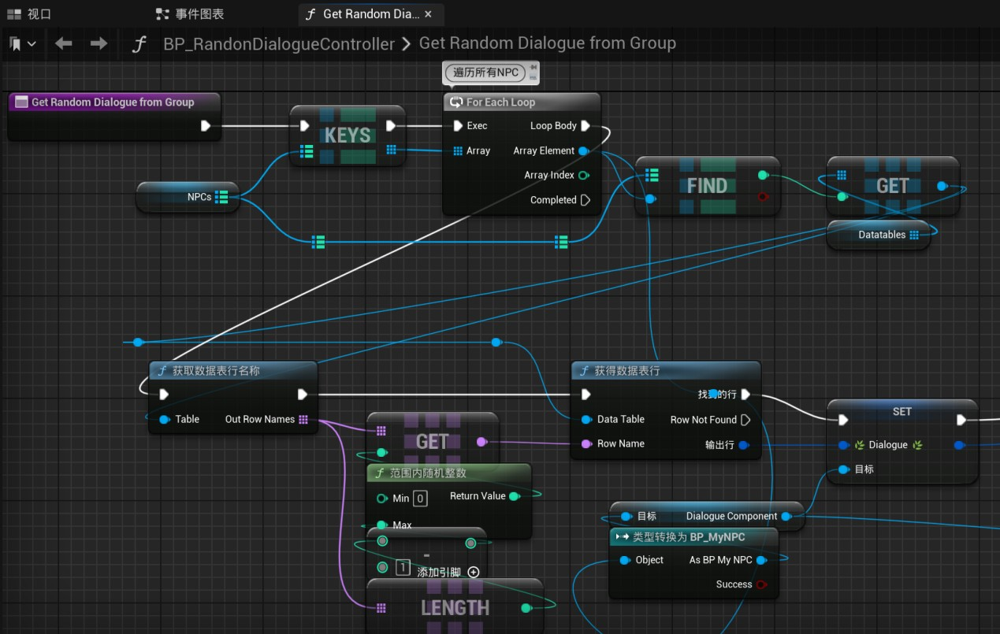 | 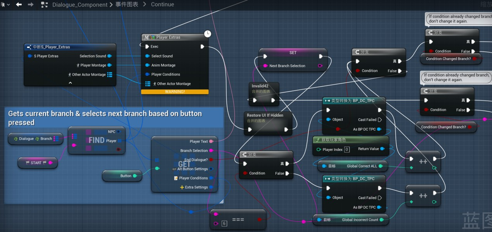 |
| 每局开始时，控制器从 NPC 对应的数据表里随机抽一行 | 分支跳转：读取当前分支，按下选项后跳到下一个分支 |
| 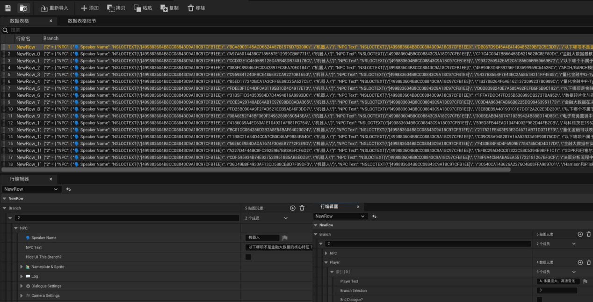 | 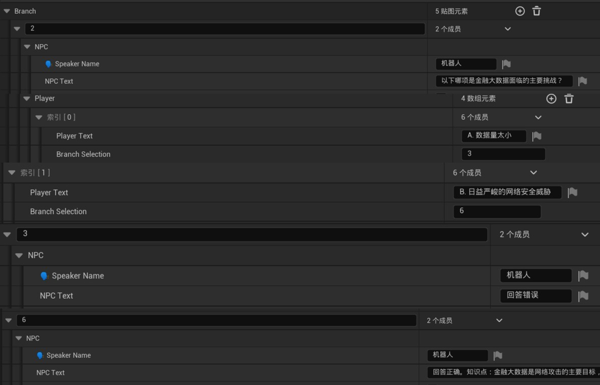 |
| 数据表里的题目行 | 其中一行：NPC 文本、玩家选项，以及每个选项跳转到的分支 |
| 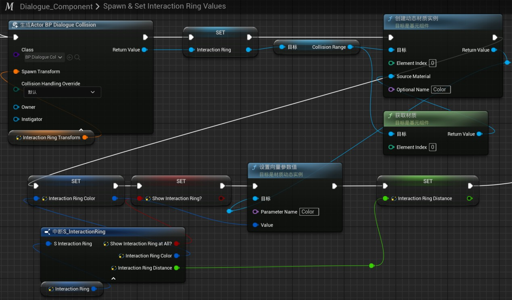 | 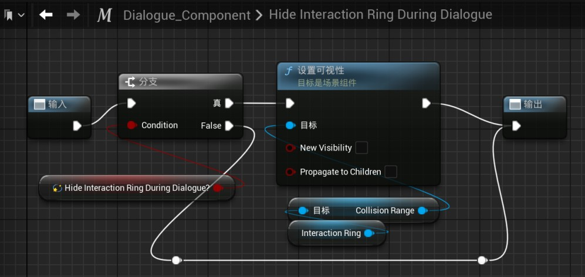 |
| 对话组件生成引导环，并设置颜色和范围 | 对话打开时隐藏引导环 |
| 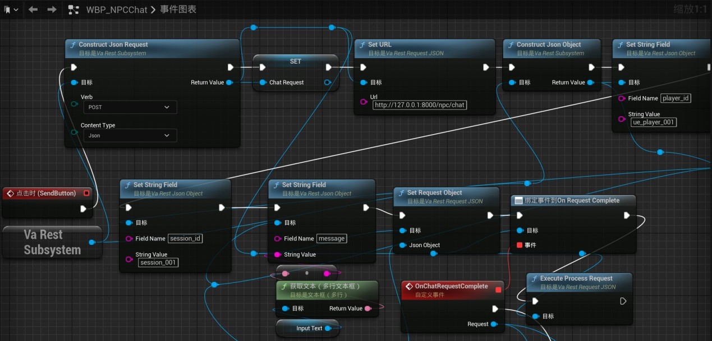 | 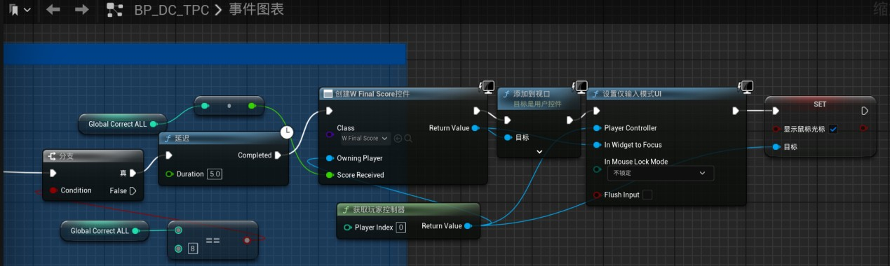 |
| 导师界面构造 JSON 请求，发到 `/npc/chat` 并处理返回 | 答对数达到目标后弹出结算界面，并把输入切换到 UI |
| 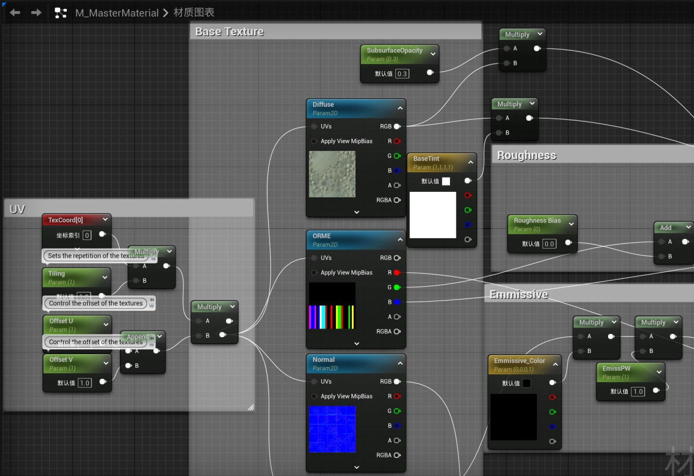 | 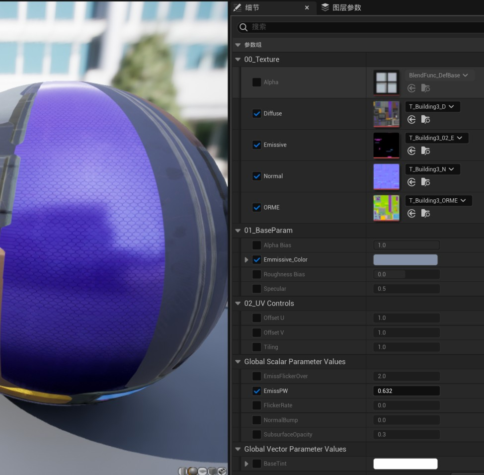 |
| 主材质：封装通用 PBR 输入和 UV 控制 | 材质实例：不改节点图，直接替换贴图、调整参数 |

| 日期 | 发生了什么 |
|---|---|
| 2026 年 4 月 | 项目随中文毕业论文一同提交，论文题目是《基于三维引擎技术的元宇宙金融教育平台设计与实现》。论文没有在这里公开 |
| 2026 年 10 月 9 日 | 发布这个展示仓库：演示视频、截图、蓝图截图和 VR 版本的照片 |
| 2026 年 10 月 11 日 | 一页纸海报，用本仓库里的截图制作 |
| 2026 年 11 月 14 日 | *System Scan* 短片页面，附条款页 |

## 技术栈

- Unreal Engine 5.5.1，蓝图
- VaRest 插件，用于蓝图里的 HTTP 和 JSON
- Python 3.11、FastAPI 0.124.4、Uvicorn 0.38.0 和 Pydantic 2.12.5
- python-docx 1.2.0 解析题库，python-dotenv 1.2.1 读取配置
- ZhipuAI SDK 2.1.5，模型 `glm-4`
- Swagger UI，用于接口测试
- Pico Neo 3，用于 VR 版本

第三方内容：城市场景是虚幻商城的赛博朋克场景资产包；对话组件是虚幻商城的对话插件，针对答题流程做了修改；蓝图里的 HTTP 和 JSON 用的是 VaRest 插件；VR 版本以 PICO 官方的 Unreal Engine 手柄交互示例工程为起点，手柄和瞬移移动来自该示例；大语言模型是通过智谱 API 调用的 GLM-4。

教学设计、题目数据表及其分支配置、随机出题、计分与结算、AI 导师界面、后端服务和测试，是我自己完成的。

## 验证证据

五个模块共 26 条测试用例，全部通过。以黑盒测试为主，接口测试通过 Swagger UI 进行，AI 导师部分做了集成测试。

| 模块 | 用例数 | 覆盖内容 |
|---|---|---|
| 教学场景 | 5 | 场景加载、NPC 交互触发、点位可达性、完成后不可重复交互、连续重开五次的随机出题 |
| 对话答题 | 5 | 题目显示、正误判定、重试回环、连点防抖、长文本显示 |
| 统计结算 | 3 | 结算触发、得分计算、重新开始后归零 |
| AI 导师 | 11 | 原题提问、同义改写、口语化提问、概念辨析、与金融无关的问题、超出题库的问题、空输入与超长输入、外部服务失败、题库不可用 |
| VR | 2 | 抛物线瞬移、场景浏览稳定性 |

其中两条用例的原文：

| 编号 | 测试内容 | 操作 | 预期 | 结果 |
|---|---|---|---|---|
| SC-004 | 已完成的 NPC 不可重复交互 | 完成某个 NPC 的题目后，再次靠近并按交互键 | 不再弹出题目，NPC 显示为已完成 | 通过 |
| SC-005 | 开局随机分配题目 | 连续重开五次，记录每局分配到的题目 ID | 单局内不重复，每局八道题，不同局之间的组合不同 | 通过 |

- **响应时间。** 对 `/npc/chat` 接口连续调用 50 次（Top-K 为 5，输出上限 700 tokens）：平均 10 秒，最快 5 秒，最慢 20 秒，没有失败。耗时主要花在模型生成上。
- **测试环境。** Windows 10/11，Unreal Engine 5.5.1；后端版本见[技术栈](#技术栈)；接口测试用 Swagger UI。
- **题库。** 下面的后端日志显示启动时加载了 115 道题，之后玩家每提问一次就有一条 `POST /npc/chat`。
- **VR。** VR 版本已在头显上实际运行并做了演示。

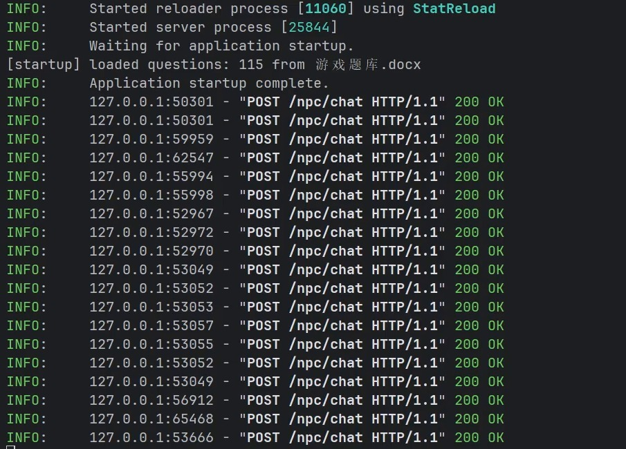

这些是我自己编写并执行的功能测试。它们说明系统做到了设计要求的事，不能说明学生用它学得更好。

## 内容与数据边界

- 题库是课程自己的材料，以一个 .docx 文件放在服务器上。启动时解析并保存在内存里，不使用数据库。题库不在这里公开。
- 只有 AI 导师会用到网络。客户端把玩家的问题发给后端，后端把它和检索到的题目一起，通过智谱 API 发给 GLM-4。
- API 密钥和其他后端配置放在服务器上的 `.env` 文件里。本仓库不含项目的任何源码、密钥或配置。
- 每次向 AI 导师提问都会带上 `player_id` 和 `session_id`。`player_id` 为后续统计预留；学习过程数据看板是下一步，不在这个项目里。
- AI 导师的回答来自外部模型，可能出错。回答里的章节和题号让学生可以拿课程内容来核对。

## 还没做完的

- 关键词检索在同义改写和长问题上排序不稳定，下一步是引入向量检索或混合检索。
- AI 导师依赖外部大模型服务，回答质量受网络、成本限制和模型输出一致性的影响，还需要补上引用一致性校验、内容过滤和更完善的异常兜底。
- 目前的测试只验证了系统能不能正常工作，没有验证学生是否学得更好。这需要在真实课堂里做研究，配一个学习过程数据看板会更方便。
- VR 版本只是简化演示。

## 这个项目说明了什么

这个项目讲的是金融，但它的大部分结构和金融无关。下面这些做法，换成培训或仿真类产品同样用得上：

- **一局有任务、有反馈、有结果。** 学习者在 3D 场景里操作，每一步都会被判定，尝试次数会被记录，最后以一个可以复盘的分数结束。
- **内容由教师掌握。** 问哪些题、在哪个答题点问、一局有多长，都在数据表和设置里调整，备课不需要打开蓝图。
- **同一个场景，屏幕和头显都能用。** 做 VR 版本时发现，菜单、鼠标点击和连续移动搬不进头显，于是换成了瞬移、放在场景里的文字和地面引导线。
- **引擎作为另一套系统的前端。** 客户端和后端之间只有一个很小的接口：发出文字，收回带出处的回答。两边可以各自修改。
- **不靠地图也能找到路。** 地标、清晰的道路布局，加上每个答题点上完成后会变色的标记，让第一次进入的人也能在场景里找到方向。
- **成文的测试用例。** 26 个用例按模块划分，写明步骤和预期结果，其中包括模型服务出错和题库缺失时的表现。

## 版权与条款

© 2026 Cyber Finance City。保留所有权利，见 [LICENSE](LICENSE)。本仓库里的文字、短片、视频、截图、蓝图截图和海报，以及
项目自己的代码和设计，未经书面许可不得转载、复制或改编。欢迎分享链接。上面列出的第三方内容保留它们各自的许可。条款、
许可与隐私：[条款页](https://zeeekrom.github.io/cyber-finance-city/film/terms.html)（英文）。

联系方式：[LinkedIn](https://www.linkedin.com/in/evan-h-165976301/)
