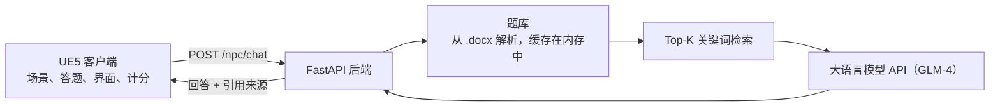

# 赛博金融都市

[English](README.md) | **中文**

一款用 Unreal Engine 5 制作的金融教育游戏。玩家在一个赛博朋克风格的城市街区里行走，找到八个机器人 NPC，分别回答一道金融题；过程中可以随时打开对话面板向 AI 导师提问，AI 会依据课程题库作答，并注明参考的是哪一道题。这是我的本科毕业设计（软件工程专业，上海杉达学院，2026 年）。

**[观看完整演示视频](media/cyber-finance-city-demo.mp4)**（3 分 28 秒，无声）· [下载 MP4](https://github.com/Zeeekrom/cyber-finance-city/raw/main/media/cyber-finance-city-demo.mp4)

本仓库只包含展示材料：演示视频和截图。Unreal 工程文件、后端源码和毕业论文不在其中。

## 玩法流程

1. 开始界面列出操作方式：WASD 移动，空格跳跃，F 对话，E 呼出 AI 导师。
2. 玩家在一个紧凑的城市街区里探索。每个 NPC 脚下有一圈发光的引导环，题目未完成时是黄色，完成后变成灰色。
3. 在 NPC 旁按 F 会弹出一道四选一的题目。答错会给出提示并回到题目重新作答，答对则显示这道题对应的知识点。
4. 按 E 打开 AI 导师，用自然语言输入问题，得到一段结构化的回答：概念解释、例子、易错点、一句话总结，以及来源的章节和题号。
5. 八个 NPC 全部完成后进入结算界面，显示得分，并可以重新开始。

得分等于题目数量除以总尝试次数，以百分比显示。答错重试会拉低分数，但不会结束本局，所以初学者只要坚持纠错，最后仍能拿到一个合理的分数。

## 游戏截图

| | |
|---|---|
|  |  |
| 开始界面与操作说明 | 城市街区，引导环标出尚未完成的 NPC |
|  |  |
| 四选一题目 | 答错后的提示与"再试一次" |
|  |  |
| 答对后显示知识点 | 结算界面与得分 |
|  |  |
| AI 导师讲解 ARCH/GARCH 模型 | 同一段回答的末尾，附有来源章节和题号 |

## 系统架构

答题部分完全在客户端内运行，离线也能用，只有 AI 导师需要联网。客户端不关心检索和模型：它只负责把问题发出去、把回答显示出来，所以更换模型或调整检索方式都不需要改动游戏本身。

## 客户端（Unreal Engine 5.5，蓝图）

- **数据表驱动的答题。** 数据表的每一行是一道题及其分支。错误选项跳到"回答错误"分支，再回到题目；正确选项跳到"回答正确"分支并结束对话。题干、选项和反馈都在数据表里编辑，不用改蓝图，也不用重新编译。
- **一个 NPC 类，多个实例。** 所有 NPC 都是同一个蓝图类的实例。每局开始时，一个控制器蓝图从各 NPC 对应章节的数据表里随机抽一行分配给它，所以每局的题目组合都不一样。客户端内置 115 道题，按章节分布在绑定到八个 NPC 点位的数据表中。
- **对话组件。** 负责生成引导环、设置颜色和交互距离、在对话期间隐藏引导环，并在结束后把 NPC 标记为已完成。文本播放速度、镜头和音效等参数也放在同一批数据表里。
- **计分与结算。** 用全局变量统计答对题数和尝试次数。答对数达到八时弹出结算界面，并把输入切换到 UI 模式。重新开始时所有计数归零。
- **场景。** 赛博朋克风格的城市街区，用高架轻轨和霓虹灯牌作为地标。材质采用一个主材质（基础色、法线、自发光、粗糙度偏置、UV 控制）加各资产的材质实例。
- **AI 导师界面。** 构造包含 `player_id`、`session_id` 和 `message` 的 JSON 请求体，发出 HTTP POST 请求，再把返回的 `answer` 字段显示在面板上。
- **VR 版本。** 面向 Pico Neo 3 头显的独立简化版本：抛物线瞬移移动，题目显示在世界空间里，通过向左走或向右走来作答。它没有复现 PC 版的全部功能。

## 后端（Python 3.11，FastAPI）

- **题库。** 题库是一个 .docx 文件。服务启动时用 python-docx 解析：规范化文本，识别章节标题，提取每道题的题号、题干、选项、答案和知识点。解析结果缓存在内存里，不使用数据库。
- **检索。** 题库规模不大，所以我用关键词计分代替了向量库。玩家的提问被切分成若干词，每命中一个词加 2 分，整句片段命中题干或知识点加 5 分，取得分最高的前 K 道题（默认 5 道）交给模型。
- **提示词。** 检索到的题目以上下文块的形式传入。提示词要求模型优先依据题库作答，题库没有时再补充通用金融知识，并保持固定的回答结构。
- **可追溯的回答。** 响应中包含 `answer`、`citations`（题号、章节、知识点）和 `used_question_ids`，最相关的一条来源还会追加在回答末尾。
- **配置。** API 密钥、模型名、题库路径、Top-K、输出长度上限和 temperature 都放在 `.env` 文件里。

一次游玩过程中的后端日志：启动时加载 115 道题，之后玩家每提问一次就有一条 `POST /npc/chat`。

## 测试

五个模块共 26 条测试用例，全部通过。以黑盒测试为主，接口测试通过 Swagger UI 进行，AI 导师部分做了集成测试。

| 模块 | 用例数 | 覆盖内容 |
|---|---|---|
| 教学场景 | 5 | 场景加载、NPC 交互触发、点位可达性、完成后不可重复交互、连续重开五次的随机出题 |
| 对话答题 | 5 | 题目显示、正误判定、重试回环、连点防抖、长文本显示 |
| 统计结算 | 3 | 结算触发、得分计算、重新开始后归零 |
| AI 导师 | 11 | 原题提问、同义改写、口语化提问、概念辨析、与金融无关的问题、超出题库的问题、空输入与超长输入、外部服务失败、题库不可用 |
| VR | 2 | 抛物线瞬移、场景浏览稳定性 |

对 `/npc/chat` 接口连续调用 50 次（Top-K 为 5，输出上限 700 tokens）：平均响应 10 秒，最快 5 秒，最慢 20 秒，没有失败。耗时主要花在模型生成上。

## 不足

- 关键词检索在同义改写和长问题上排序不稳定，下一步是引入向量检索或混合检索。
- AI 导师依赖外部大模型服务，回答质量受网络、成本限制和模型输出一致性的影响，还需要补上引用一致性校验、内容过滤和更完善的异常兜底。
- 目前的测试只验证了系统能不能正常工作，没有验证学生是否学得更好，这需要在真实课堂里做对照研究。
- VR 版本只是简化演示。

## 工具

Unreal Engine 5.5.1（蓝图）、Python 3.11、FastAPI、Uvicorn、Pydantic、python-docx、python-dotenv、ZhipuAI SDK 与 GLM-4、Swagger UI、Pico Neo 3。

## 论文与相关发表

本项目随毕业论文一同提交，论文题目是《基于三维引擎技术的元宇宙金融教育平台设计与实现》（2026 年 4 月）。论文没有在这里公开。

我参与合著的一篇相关论文：[Exploring User Experience and Learning Motivation as Key Mediators in Metaverse-Based Financial Big Data Education](https://doi.org/10.1145/3802133.3802247)（IECA 2026，ACM）。

## 版权与联系

© 2026 黄钰祥（Yuxiang Huang）。视频和截图仅供作品集展示，如需使用请先联系我。

联系方式：[LinkedIn](https://www.linkedin.com/in/evan-h-165976301/)
