# 赛博金融都市

[English](README.md) | **中文**

一款用 Unreal Engine 5 制作的金融教育游戏。玩家在一个赛博朋克风格的城市街区里行走，找到八个机器人 NPC，分别回答一道金融题；过程中可以随时打开对话面板向 AI 导师提问，AI 会依据课程题库作答，并注明参考的是哪一道题。另有一个在 Pico 头显上运行的 [VR 版本](#vr-版本)。这是我的本科毕业设计（软件工程专业，上海杉达学院，2026 年）。

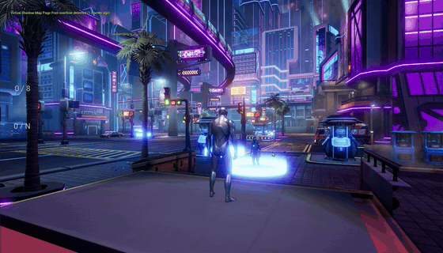

**[观看完整演示视频](media/cyber-finance-city-demo.mp4)**（3 分 28 秒，无声）· [下载 MP4](https://github.com/Zeeekrom/cyber-finance-city/raw/main/media/cyber-finance-city-demo.mp4)

本仓库只包含展示材料：演示视频、截图和蓝图截图。Unreal 工程文件、后端源码和毕业论文不在其中。

## 目录

- [为什么做这个项目](#为什么做这个项目)
- [面向谁](#面向谁)
- [玩法流程](#玩法流程)
- [设计原则](#设计原则)
- [游戏截图](#游戏截图)
- [系统架构](#系统架构)
- [客户端（Unreal Engine 5.5，蓝图）](#客户端unreal-engine-55蓝图)
- [蓝图与材质](#蓝图与材质)
- [VR 版本](#vr-版本)
- [后端（Python 3.11，FastAPI）](#后端python-311fastapi)
- [内容怎么维护](#内容怎么维护)
- [测试](#测试)
- [不足与下一步](#不足与下一步)
- [工具](#工具)

## 为什么做这个项目

我调研过的教学工具往往只做好了一件事：有的 3D 或 VR 场景很好看，但进去之后没什么可做的；有的接了 AI 对话，懂通用知识，却不了解这门课本身。我想做一个把三件事放在一起的平台：一个值得逛的场景，嵌在场景里的练习题，以及一个绑定课程题库、回答可以核对的 AI 导师。

## 面向谁

| 用户 | 需要什么 | 平台提供什么 |
|---|---|---|
| 学生 | 在动手中学金融，卡住时有人讲解 | 可以探索的 3D 场景、离线可用的答题，以及可以追问的 AI 导师 |
| 教师 | 控制教什么、什么时候教 | 题目和反馈在表格里编辑，并可以指定每个 NPC 从哪些章节出题 |
| 管理员 | 让系统在课堂上稳定运行 | 对话、音效和提示的参数都在表格里，后端配置集中在一个 `.env` 文件 |

## 玩法流程

1. 开始界面列出操作方式：WASD 移动，空格跳跃，F 对话，E 呼出 AI 导师。
2. 玩家在一个紧凑的城市街区里探索。每个 NPC 脚下有一圈发光的引导环，题目未完成时是黄色，完成后变成灰色。
3. 在 NPC 旁按 F 会弹出一道四选一的题目。答错会给出提示并回到题目重新作答，答对则显示这道题对应的知识点。
4. 按 E 打开 AI 导师，用自然语言输入问题，得到一段结构化的回答：概念解释、例子、易错点、一句话总结，以及来源的章节和题号。
5. 八个 NPC 全部完成后进入结算界面，显示得分，并可以重新开始。

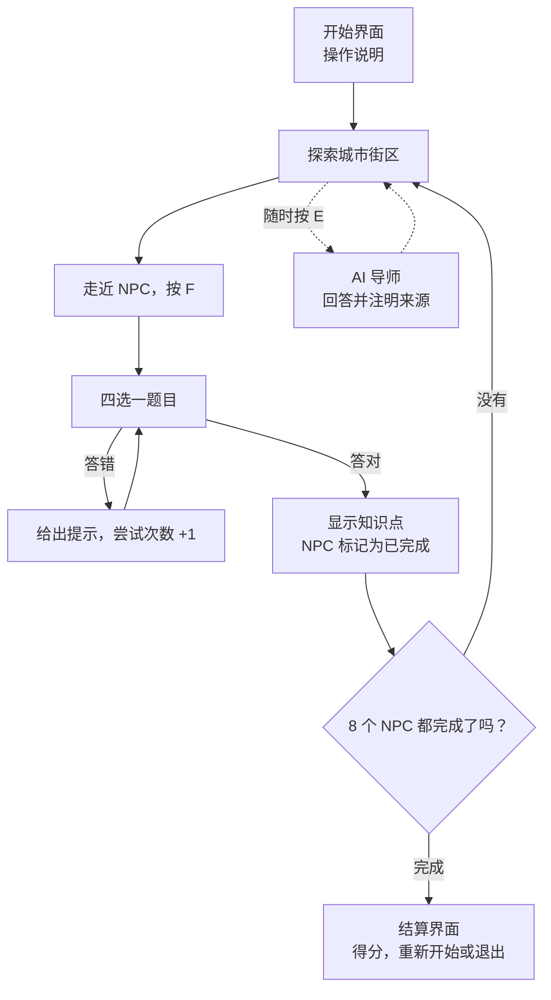

得分等于题目数量除以总尝试次数，以百分比显示。答错重试会拉低分数，但不会结束本局，所以初学者只要坚持纠错，最后仍能拿到一个合理的分数。

## 设计原则

- **练习、反馈、记录、再练习。** 每次作答都有即时反馈，尝试次数会被记录，结算界面给玩家一个复盘的依据。
- **低门槛。** 场景加载完就开始，没有需要先设置的选项，结束时统一弹出一个界面，可以重新开始或退出。
- **可配置、可复用。** 对话框布局、文本速度、提示和音效都是参数，同一套对话组件可以用在所有 NPC 上。
- **离线优先，联网增强。** 答题不需要网络，只有 AI 导师需要，所以网络不好的教室也能跑完主流程。
- **宽容的计分。** 答错只会增加一次尝试，玩家可以接着答。
- **回答可追溯。** AI 导师的每个回答都带着它所依据的章节和题号。

## 游戏截图

| | |
|---|---|
| 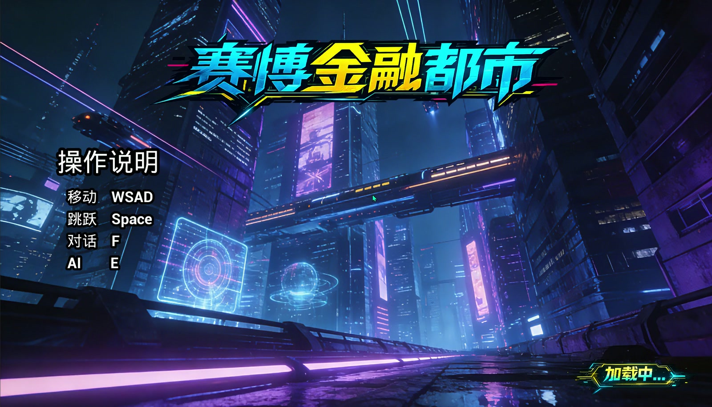 | 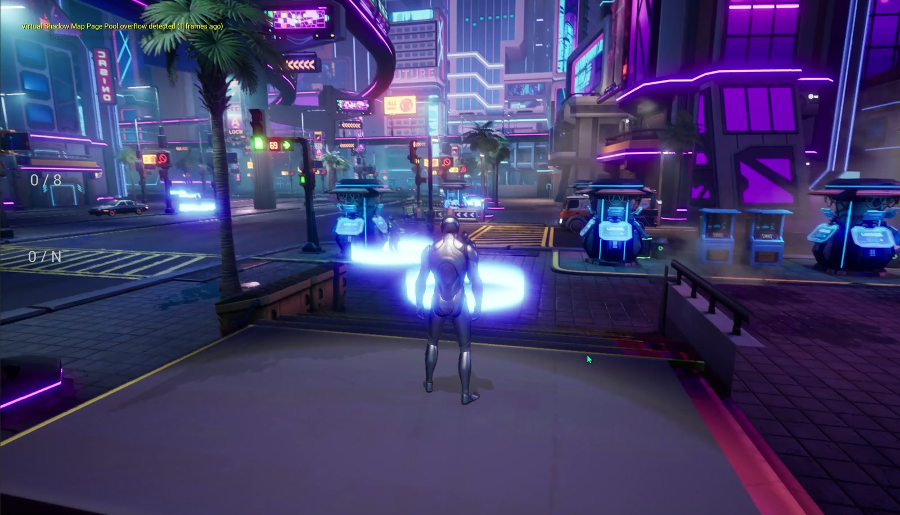 |
| 开始界面与操作说明 | 城市街区，引导环标出尚未完成的 NPC |
| 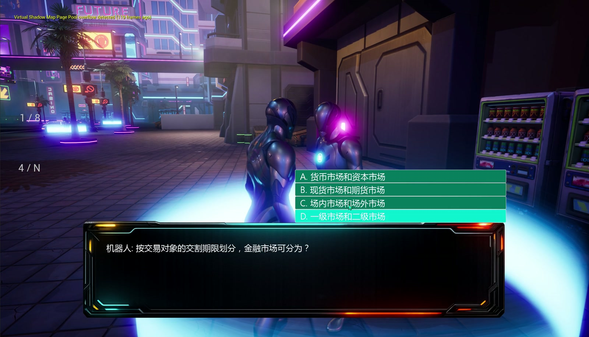 | 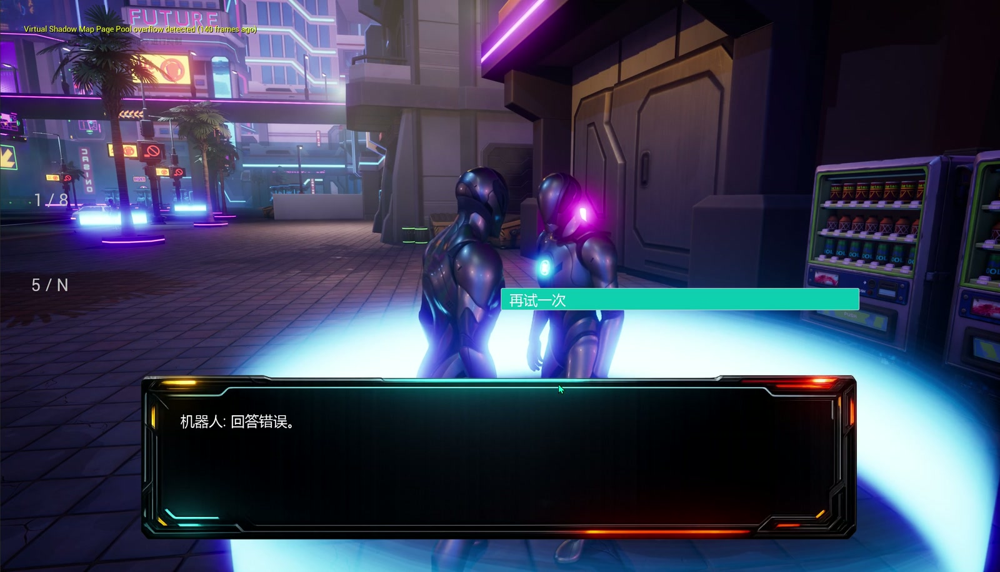 |
| 四选一题目 | 答错后的提示与"再试一次" |
| 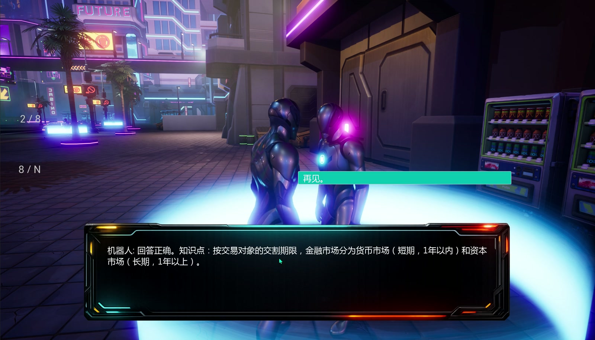 | 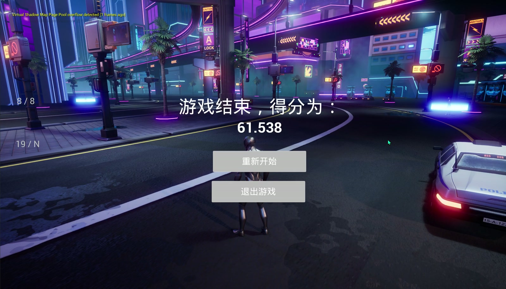 |
| 答对后显示知识点 | 结算界面与得分 |
| 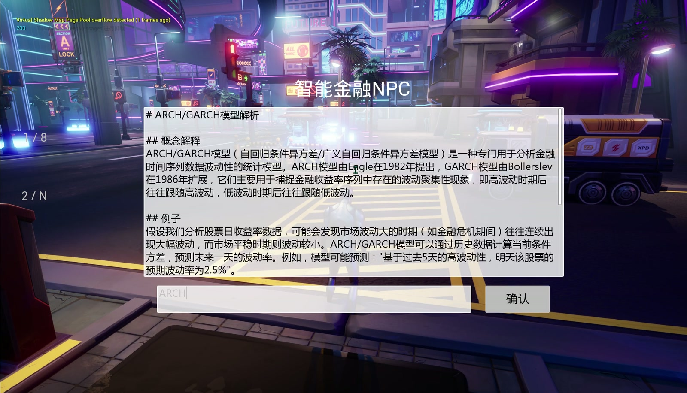 | 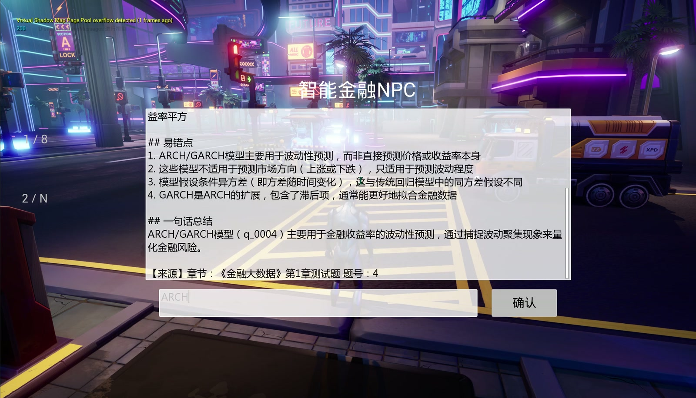 |
| AI 导师讲解 ARCH/GARCH 模型 | 同一段回答的末尾，附有来源章节和题号 |

## 系统架构

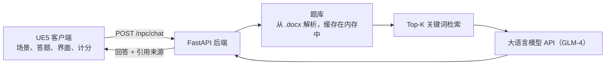

答题部分完全在客户端内运行，离线也能用，只有 AI 导师需要联网。客户端不关心检索和模型：它只负责把问题发出去、把回答显示出来，所以更换模型或调整检索方式都不需要改动游戏本身。

整个系统分成六个模块：

| 模块 | 负责什么 |
|---|---|
| 教学场景 | 渲染城市街区，给每个学习点位一个玩家找得到的位置 |
| 对话答题 | 显示题目和选项，判断正误，并把 NPC 标记为已完成 |
| AI 导师 | 独立的自然语言提问入口 |
| 统计结算 | 记录尝试次数和答对数，计算得分并结束本局 |
| 内容与配置 | 题目表格、对话参数和后端配置 |
| VR | 用于在头显里浏览场景和答题的简化版本 |

实现顺序也是这样：先在客户端做完离线主流程，再接入后端和 AI 导师，最后补上引用来源和结算，把流程闭合。

## 客户端（Unreal Engine 5.5，蓝图）

| | |
|---|---|
| 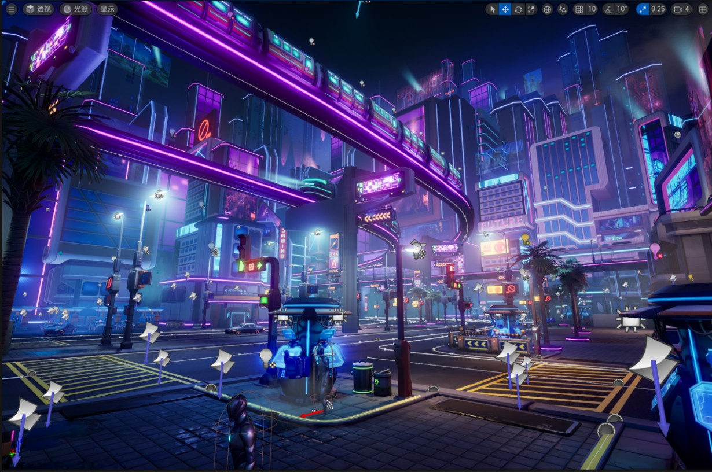 | 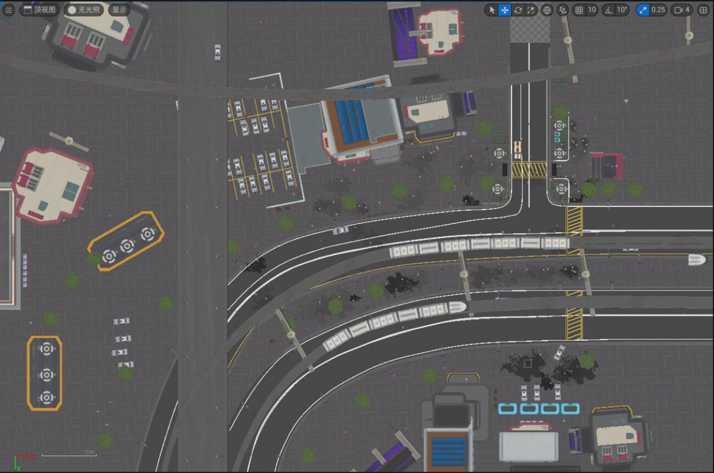 |
| 街道视角下的城市街区 | 编辑器里的顶视图：道路、动线和地标 |

- **数据表驱动的答题。** 数据表的每一行是一道题及其分支。错误选项跳到"回答错误"分支，再回到题目；正确选项跳到"回答正确"分支并结束对话。题干、选项和反馈都在数据表里编辑，不用改蓝图，也不用重新编译。
- **一个 NPC 类，多个实例。** 所有 NPC 都是同一个蓝图类的实例。每局开始时，一个控制器蓝图从各 NPC 对应章节的数据表里随机抽一行分配给它，所以每局的题目组合都不一样。客户端内置 115 道题，按章节分布在绑定到八个 NPC 点位的数据表中。
- **对话组件。** 负责生成引导环、设置颜色和交互距离、在对话期间隐藏引导环，并在结束后把 NPC 标记为已完成。文本播放速度、镜头和音效等参数也放在同一批数据表里。
- **计分与结算。** 用全局变量统计答对题数和尝试次数。答对数达到八时弹出结算界面，并把输入切换到 UI 模式。重新开始时所有计数归零。
- **场景。** 一个紧凑的赛博朋克城市街区。高架轻轨和霓虹灯牌是地标，道路布局让八个点位之间的路线清楚，玩家不用地图也能找到每个 NPC。
- **材质。** 一个主材质（基础色、法线、自发光、粗糙度偏置、UV 控制）加各资产的材质实例。霓虹效果通过在实例里替换贴图、调整自发光强度来实现。
- **开始界面。** 除了列出操作方式，也用来覆盖场景的预加载，减少刚进场景时的卡顿。
- **AI 导师界面。** 构造包含 `player_id`、`session_id` 和 `message` 的 JSON 请求体，发出 HTTP POST 请求，再把返回的 `answer` 字段显示在面板上。
- **VR 版本。** 面向 Pico 头显的独立简化工程，见 [VR 版本](#vr-版本)。

## 蓝图与材质

| | |
|---|---|
| 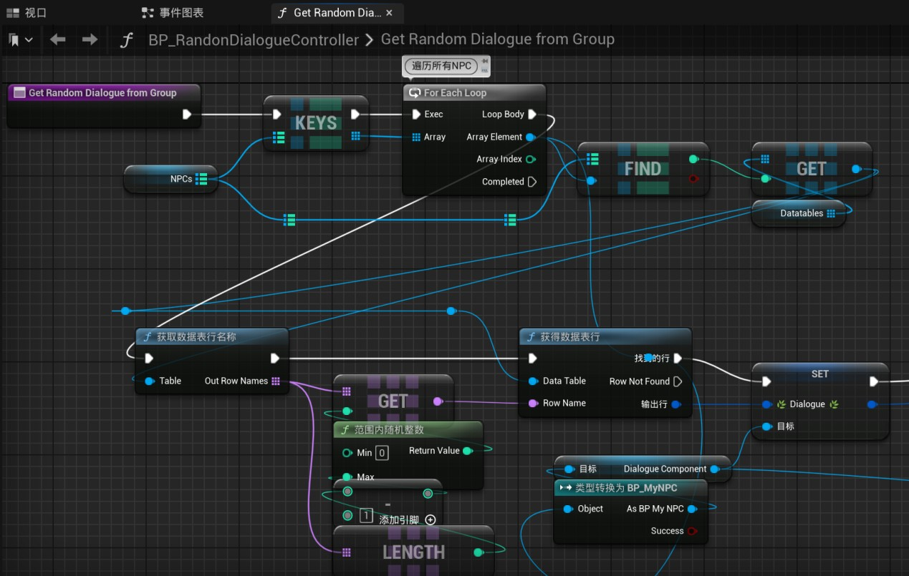 | 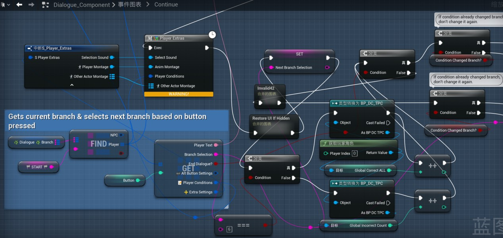 |
| 每局开始时，控制器从 NPC 对应的数据表里随机抽一行 | 分支跳转：读取当前分支，按下选项后跳到下一个分支 |
| 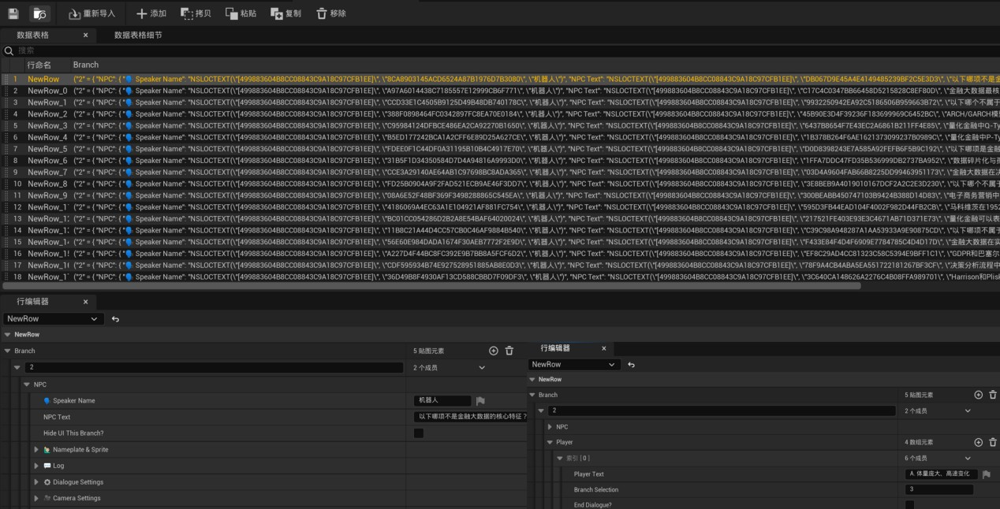 | 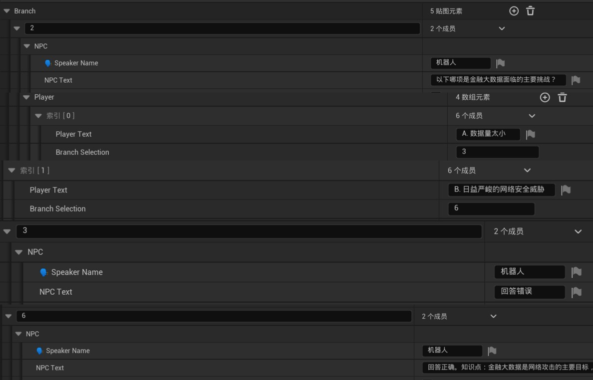 |
| 数据表里的题目行 | 其中一行：NPC 文本、玩家选项，以及每个选项跳转到的分支 |
| 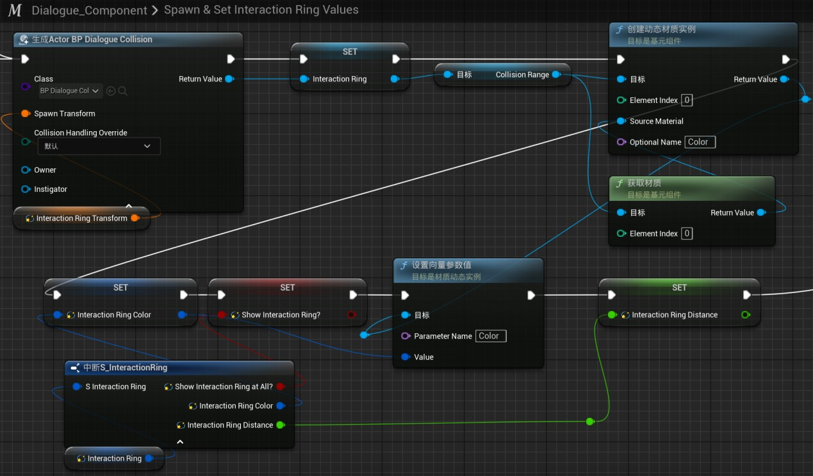 | 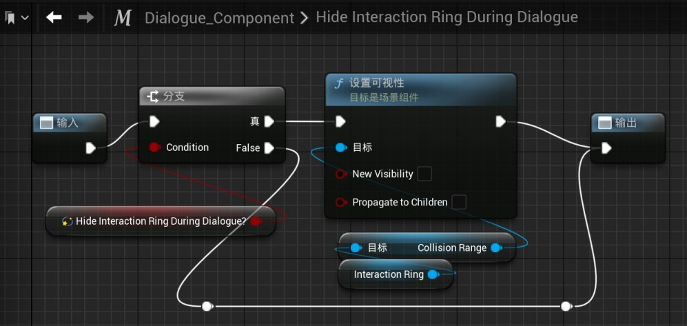 |
| 对话组件生成引导环，并设置颜色和范围 | 对话打开时隐藏引导环 |
| 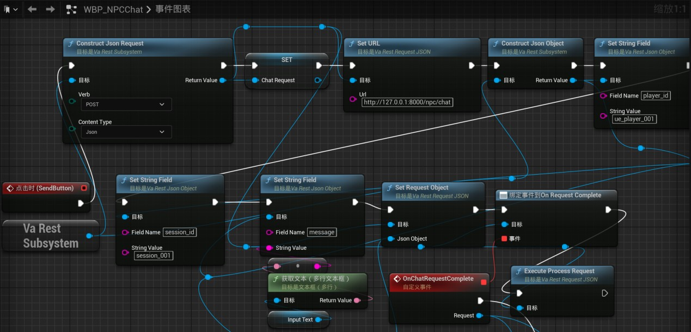 | 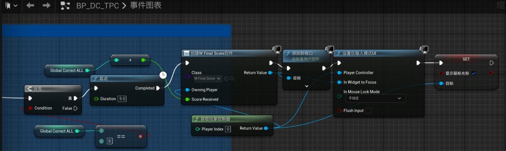 |
| 导师界面构造 JSON 请求，发到 `/npc/chat` 并处理返回 | 答对数达到目标后弹出结算界面，并把输入切换到 UI |
| 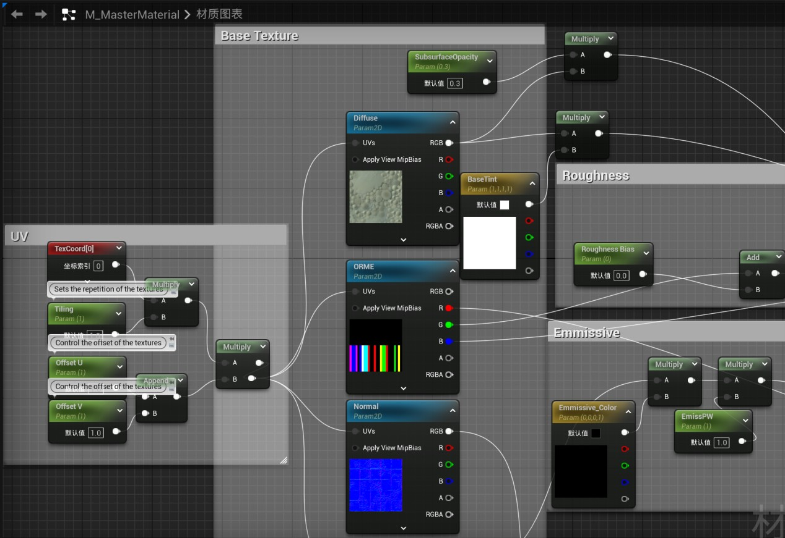 | 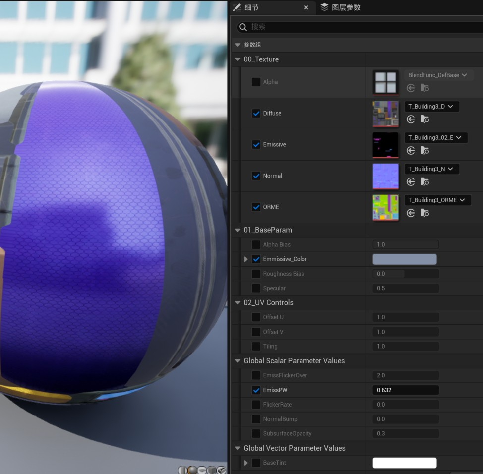 |
| 主材质：封装通用 PBR 输入和 UV 控制 | 材质实例：不改节点图，直接替换贴图、调整参数 |

## VR 版本

面向 Pico 头显（Pico Neo 3 及以上）的独立简化工程，已在头显上实际运行并做了演示。它的目的是验证场景浏览和基础交互在 VR 里是否可行，而不是复现 PC 版。

| | |
|---|---|
| 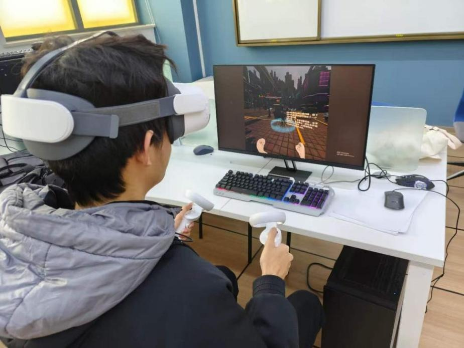 | 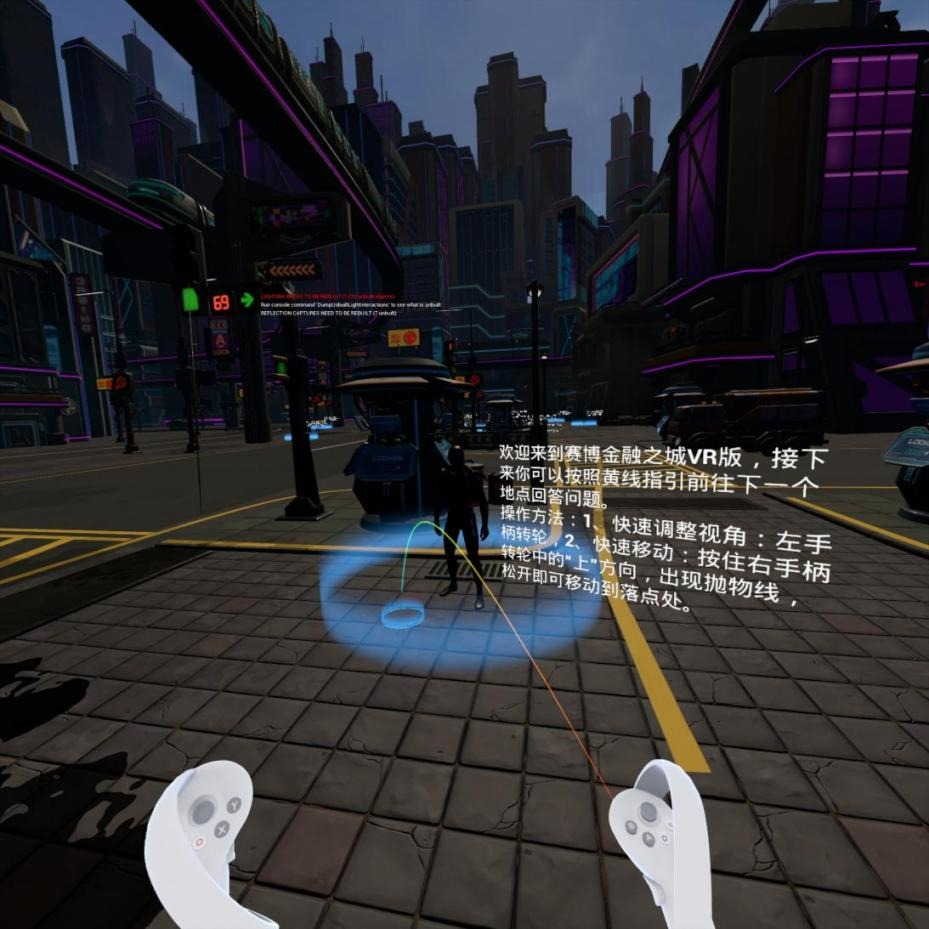 |
| VR 版本的使用场景，头显画面同步显示在显示器上 | 头显内画面：手柄、瞬移抛物线，以及放在场景里的操作说明 |

- **移动。** 抛物线瞬移：右手柄摇杆向前推出现抛物线，松开后移动到落点；左手柄摇杆调整视角。瞬移能让玩家快速到达 NPC 附近，也比连续移动更不容易眩晕。
- **不用菜单的答题。** 为了避开 VR 里繁琐的 UI 点击和控件对焦问题，没有沿用四选一面板。题干和反馈以文字形式放在场景里，玩家通过向左走或向右走来作答，答错可以重选，答对进入下一题。
- **引导。** 地面上的黄线把玩家从一道题引到下一道题。

## 后端（Python 3.11，FastAPI）

- **题库。** 题库是一个 .docx 文件。服务启动时用 python-docx 解析：规范化文本，识别章节标题，提取每道题的题号、题干、选项、答案和知识点。解析结果缓存在内存里，不使用数据库。
- **检索。** 题库规模不大，所以我用关键词计分代替了向量库。玩家的提问被切分成若干词，每命中一个词加 2 分，整句片段命中题干或知识点加 5 分，取得分最高的前 K 道题（默认 5 道）交给模型。
- **提示词。** 检索到的题目以上下文块的形式传入。提示词要求模型优先依据题库作答，题库没有时再补充通用金融知识，并保持固定的回答结构。
- **可追溯的回答。** 响应中包含 `answer`、`citations`（题号、章节、知识点）和 `used_question_ids`，最相关的一条来源还会追加在回答末尾。
- **配置。** API 密钥、模型名、题库路径、Top-K、输出长度上限和 temperature 都放在 `.env` 文件里。

唯一的接口 `POST /npc/chat`：

| 字段 | 方向 | 类型 | 含义 |
|---|---|---|---|
| `player_id` | 请求 | string | 学习者标识，为后续统计预留 |
| `session_id` | 请求 | string | 标识一次连续的答疑会话 |
| `message` | 请求 | string | 玩家输入的问题 |
| `answer` | 响应 | string | 生成的讲解，附来源提示 |
| `used_question_ids` | 响应 | list | 本次检索命中的题目 |
| `citations` | 响应 | list | 每条来源的题号、章节和知识点 |

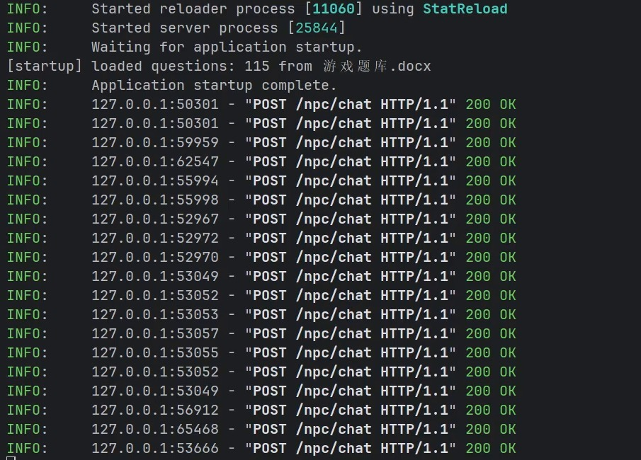

一次游玩过程中的后端日志：启动时加载 115 道题，之后玩家每提问一次就有一条 `POST /npc/chat`。

## 内容怎么维护

下面这些都不需要改蓝图或重新打包：

- **新增或修改题目。** 编辑数据表里的行（题干、选项、反馈、分支）。
- **每个 NPC 问什么。** 指定各点位从哪张章节表里出题，配合当周的教学重点。
- **对话的手感。** 文本速度、提示、镜头和音效都是表里的参数。
- **一局的长度。** NPC 数量和触发结算的答对数是可调的设置。
- **AI 导师怎么回答。** Top-K、输出长度上限和模型在 `.env` 里改，题库文档在服务器上替换。

## 测试

五个模块共 26 条测试用例，全部通过。以黑盒测试为主，接口测试通过 Swagger UI 进行，AI 导师部分做了集成测试。

| 模块 | 用例数 | 覆盖内容 |
|---|---|---|
| 教学场景 | 5 | 场景加载、NPC 交互触发、点位可达性、完成后不可重复交互、连续重开五次的随机出题 |
| 对话答题 | 5 | 题目显示、正误判定、重试回环、连点防抖、长文本显示 |
| 统计结算 | 3 | 结算触发、得分计算、重新开始后归零 |
| AI 导师 | 11 | 原题提问、同义改写、口语化提问、概念辨析、与金融无关的问题、超出题库的问题、空输入与超长输入、外部服务失败、题库不可用 |
| VR | 2 | 抛物线瞬移、场景浏览稳定性 |

其中两条用例：

| 编号 | 测试内容 | 操作 | 预期 | 结果 |
|---|---|---|---|---|
| SC-004 | 已完成的 NPC 不可重复交互 | 完成某个 NPC 的题目后，再次靠近并按交互键 | 不再弹出题目，NPC 显示为已完成 | 通过 |
| SC-005 | 开局随机分配题目 | 连续重开五次，记录每局分配到的题目 ID | 单局内不重复，每局八道题，不同局之间的组合不同 | 通过 |

测试环境：

| | |
|---|---|
| 客户端 | Windows 10/11，Unreal Engine 5.5.1 |
| 后端 | Python 3.11，FastAPI 0.124.4，Uvicorn 0.38.0，Pydantic 2.12.5 |
| 文件与配置 | python-dotenv 1.2.1，python-docx 1.2.0 |
| 模型服务 | ZhipuAI SDK 2.1.5，模型 `glm-4` |
| 关键参数 | Top-K 为 5，输出上限 700 tokens |
| 测试工具 | Swagger UI |

对 `/npc/chat` 接口连续调用 50 次（Top-K 为 5，输出上限 700 tokens）：平均响应 10 秒，最快 5 秒，最慢 20 秒，没有失败。耗时主要花在模型生成上。

## 不足与下一步

- 关键词检索在同义改写和长问题上排序不稳定，下一步是引入向量检索或混合检索。
- AI 导师依赖外部大模型服务，回答质量受网络、成本限制和模型输出一致性的影响，还需要补上引用一致性校验、内容过滤和更完善的异常兜底。
- 目前的测试只验证了系统能不能正常工作，没有验证学生是否学得更好。这需要在真实课堂里做对照研究，配一个学习过程数据看板会更方便。
- VR 版本只是简化演示。

## 工具

Unreal Engine 5.5.1（蓝图）、用于 HTTP 和 JSON 的 VaRest 插件、Python 3.11、FastAPI、Uvicorn、Pydantic、python-docx、python-dotenv、ZhipuAI SDK 与 GLM-4、Swagger UI、Pico Neo 3。

## 论文与相关发表

本项目随毕业论文一同提交，论文题目是《基于三维引擎技术的元宇宙金融教育平台设计与实现》（2026 年 4 月）。论文没有在这里公开。

我参与合著的一篇相关论文：[Exploring User Experience and Learning Motivation as Key Mediators in Metaverse-Based Financial Big Data Education](https://doi.org/10.1145/3802133.3802247)（IECA 2026，ACM）。

## 版权与联系

© 2026 黄钰祥（Yuxiang Huang）。视频和截图仅供作品集展示，如需使用请先联系我。

联系方式：[LinkedIn](https://www.linkedin.com/in/evan-h-165976301/)
